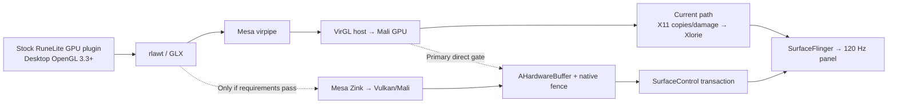

# Tablite 120 FPS Optimization and Frame-Telemetry Plan

Status: approved implementation plan  
Primary device: stock, unrooted Samsung Tab S10 Ultra (SM-X920)  
Target output: native 2960×1848 landscape at 120 Hz  
Recorded: 2026-07-28

## Summary

The first milestone targets the connected stock, unrooted Samsung Tab S10 Ultra/SM-X920 at native 2960×1848 landscape output:

- At least 118 unique presented frames per second for two minutes.
- No more than 1% missed 8.33 ms presentation deadlines.
- No stall over 50 ms.
- Current AA, draw distance, UI scale, and other visual settings remain unchanged.
- Detailed captures remain local: a lightweight on-device flight recorder plus host-pulled Perfetto, JFR, Mali, and frame-correlation bundles.
- Developer options and ADB profiling are permitted, but no runtime solution may require root, custom SELinux policy, system-partition edits, or private Android APIs.

RuneLite’s client, gamepack, GPU plugin, and Java plugin code remain byte-identical to upstream. Changes are permitted in Tablite, rlawt native bridges, LWJGL native compatibility/loading, Mesa, VirGL, X11/Xlorie, and Android presentation.

Before further runtime optimization, the project must pass the canonical
architecture and lint gate documented in
`docs/architecture/application-architecture.md`. Strong rules are enabled
without a debt baseline, every exposed violation is fixed, and the analyzer
must attribute each check's runtime while completing in less than 60 seconds.
This prerequisite locks the DI, telemetry, frame-metric, process, source
ownership, and RuneLite-integrity seams used by the remainder of this plan.

The implementation begins with two parallel tracks:

1. Build the end-to-end frame flight recorder and decompose the proven native-X11/VirGL path.
2. Run a bounded feasibility spike for desktop-GL/VirGL output → AHardwareBuffer → SurfaceControl.

If the measured X11 path retains a serialized stage above the 8.33 ms service budget after its highest-confidence optimization, the direct presentation route becomes the primary effort rather than continuing indefinite X11 tuning.

## Research-Backed Architecture

- The current RuneLite GPU plugin creates LWJGL desktop-OpenGL capabilities and hard-requires OpenGL 3.3; it is not a GLES renderer. See [GpuPlugin.java](https://github.com/runelite/runelite/blob/02b41869adaf688c1f6f0bec63f1a18aa57a1c64/runelite-client/src/main/java/net/runelite/client/plugins/gpu/GpuPlugin.java#L268-L317).
- Android’s public NDK driver interface provides OpenGL ES, not desktop OpenGL ([NDK graphics APIs](https://developer.android.com/ndk/guides/stable_apis)).
- The experimental direct producer currently creates a GLES context in `third_party/rlawt/rlawt_android.c`. Fixing its present linker failure would therefore reveal a second, fundamental OpenGL capability failure.
- The proven native-Termux/X11 path has already run the stock GPU plugin through Mesa/VirGL. It remains the control and starting point.
- Android publicly supports direct HardwareBuffer submission with acquire and release fences through [`SurfaceControl.Transaction.setBuffer`](https://developer.android.com/reference/android/view/SurfaceControl.Transaction#setBuffer(android.view.SurfaceControl,%20android.hardware.HardwareBuffer,%20android.hardware.SyncFence,%20java.util.function.Consumer)).
- Zink can provide desktop OpenGL over Vulkan, but only if the exact Mali Vulkan driver passes Mesa’s current feature profiles and functional tests ([Mesa Zink](https://docs.mesa3d.org/drivers/zink.html)).

Current evidence shows the panel is not the initial ceiling:

- Android Choreographer and the panel ran near 120 Hz while RuneLite/Xlorie content remained around 26–28 FPS.
- Native gameplay captures recorded `glXSwapBuffers` commonly taking roughly 27–38 ms, already several times the full 8.33 ms interval. See `runelite-tablet/docs/logs/pipeline-observability.md`.
- The latest direct attempt produces no GPU frames because Android’s private GLES dependency cannot load from the Termux linker namespace. See `_tmp_runelite_native_current2.log`. This is not safely solvable by relying on additional private system libraries.

## Phase 0 — Preserve and Freeze the Starting Point

- Checkpoint the current dirty direct-surface prototype unchanged before overlapping work. Keep whole files intact when forming commits and never add co-author trailers.
- Treat the following as independent lanes:

  - `native_x11_virgl_gpu`: primary proven baseline.
  - `proot_x11_virgl_gpu`: legacy comparison.
  - `direct_virgl_ahb`: experimental target.
  - `direct_zink_ahb`: gated alternative.
  - `software_x11`: correctness/fallback control only.

- Capture one archival run with the currently installed RuneLite build.
- Update through the project’s normal official RuneLite flow, record all JAR/native hashes, and freeze that exact version for the optimization campaign. Client upgrades must never be mixed into a renderer A/B.
- Add an artifact-integrity manifest that proves:

  - RuneLite client, gamepack, GPU plugin, and plugin classes match official artifacts.
  - Patched rlawt/LWJGL JARs retain upstream Java-class hashes.
  - Only explicitly listed native compatibility payloads differ.
  - No gameplay automation, protocol changes, or modified RuneLite plugin behavior exists.

- Redact credentials, tokens, account identifiers, and authentication JVM properties before expanding telemetry. Bundles must not collect chat text, typed keys, screenshots, or gameplay packet contents.
- Correct known observability defects before trusting new baselines:

  - Rename the Android Choreographer metric to `host_vsync_callback_rate`; it is not game FPS.
  - Replace the 12 ms jank threshold with target-rate-aware deadlines.
  - Reset all frame history on session changes.
  - Stop labeling a run CPU- or IPC-bound solely from rlawt gap/swap ratios.
  - Fix direct buffer-index and sequence logging.
  - Fix stale GPU-query frame attribution.
  - Capture Xlorie wait reason before sleeping.
  - Add a renderer heartbeat independent of successfully rendered frames.
  - Surface all dropped telemetry events instead of silently evicting them.

## Phase 1 — Build the Frame Flight Recorder

Implementation checkpoint (2026-07-28):

- rlawt SUMMARY mode now emits `RLT_FRAME_RATE_V1` from exact, monotonic
  post-swap sequence intervals. The app and host analyzer independently
  recompute the rate and reject inconsistent, duplicate, reordered,
  overlapping, stale, or cross-run windows.
- The app dashboard reports `produced_fps` only from that producer sequence.
  It reports accepted, submitted, and presented FPS as unavailable until
  their events are correlated to the same sequence.
- Xlorie redraws, Choreographer callbacks, X11 damage/Present activity,
  BufferQueue activity, release callbacks, and synthetic glxgears output are
  explicitly named stage rates in hertz. They cannot be promoted to FPS by
  the canonical analyzer.
- Presentation correlation for the native X11 path remains incomplete. No
  current number is accepted as uniquely presented FPS.

### Shared identity and clock contract

- Generate a random `run_id` in the Android app and pass it to the launcher, rlawt, Mesa/VirGL telemetry, Xlorie, and host collector.
- Use `CLOCK_MONOTONIC` in native components and `System.nanoTime()` in Java/Kotlin.
- Record boot ID plus realtime, monotonic, and boottime clock anchors at capture start.
- Perform a producer/consumer clock handshake and record round-trip uncertainty.
- Generate a 64-bit `frame_seq` at the rlawt frame boundary:

  - `previous swap return → current swap entry` is the externally observable frame-generation interval.
  - Swap blocking, GPU completion, transport, presentation, and buffer release remain distinct spans.
  - Direct transport carries `frame_seq` explicitly.
  - X11 uses matching per-client/window GLX swap ordinals. Validate exact agreement over 10,000 synthetic swaps; add a same-connection ordered marker only if ordinals diverge.

### Event schema

Every `FrameEventV1` contains:

- Schema version, run ID, backend, process/thread IDs.
- Frame sequence, buffer index, pool generation, and X11/EGL/SurfaceControl frame identifier.
- Stage and event enums.
- Monotonic begin/end and thread CPU time.
- Dimensions, stride, damaged pixels, bytes transferred, commands, queue depth, and configuration hash where relevant.
- Status such as presented, duplicate, superseded, dropped, starved, timed out, unsupported, or telemetry lost.

Every instrumented API handoff must emit or aggregate:

- The incoming and outgoing `frame_seq`, plus any API-native frame, fence,
  buffer, resource, connection, window, or transaction identifier.
- Monotonic begin/end time and calling-thread CPU time.
- Input/output bytes, commands, damage pixels, dimensions, format, and
  configuration hash when the handoff can transform data.
- Queue depth and oldest-item age before and after the call.
- Wait reason and wait duration, including socket, fence, lock, condition,
  dequeue, acknowledgment, compositor, and buffer-release waits.
- Outcome and ownership transfer: accepted, submitted, completed, dropped,
  duplicated, superseded, timed out, unsupported, or telemetry lost.

Instrumentation escalates locally. SUMMARY first identifies the largest
serialized stage. BURST then records that stage's API handoffs. Only the
specific slow handoff is expanded with DEEP counters or traces. A downstream
rate may never be substituted for a missing upstream or presentation event.

Define rates separately:

- `produced_fps`: distinct rlawt producer frames.
- `accepted_fps`: distinct frames accepted downstream.
- `submitted_fps`: distinct EGL swaps or SurfaceControl transactions.
- `presented_fps`: distinct producer sequences confirmed on-screen.
- `display_vsync_hz`: physical panel cadence.
- `frame_age`: producer boundary to actual presentation.

### Telemetry modes

- `OFF`: clean benchmark with no frame recorder.
- `SUMMARY`: lock-free counters and histograms.
- `BURST`: fixed-size in-memory per-frame ring retaining five seconds before and after a detected miss or stall.
- `DEEP`: short invasive diagnostics using JFR, AGI, VirGL/API traces, `glFinish`, or XSync.

Hot paths may not perform file I/O, logcat calls, stack-trace allocation, blocking export, or per-frame string formatting. Fixed-size binary records go into bounded rings and background workers flush batches. If full, telemetry is dropped and counted; rendering is never blocked.

## Phase 2 — Instrument the Complete Pipeline

| Layer | Required frame telemetry | Burst/deep additions |
|---|---|---|
| RuneLite JVM without changing RuneLite | Client/AWT thread CPU versus wall time, runnable/blocked/parked state, inter-swap frame-generation period | JFR execution samples, GC, safepoints, JIT, allocations, locks, socket waits; optional GL-call interposer |
| rlawt/Mesa guest | AWT/JNI lock time, GL flush, asynchronous fence insert/signal, swap entry/return, context changes and errors | `glFinish`/XSync only in DEEP mode; timer queries only when genuinely supported |
| Virpipe/vtest | Commands and bytes per frame, socket write blocking, read/ack time, flush/fence round trips, outstanding queue depth | Packaged VirGL trace backend after verifying it is built |
| VirGL host | Receive, decode, submit, resource copy, host-fence create/signal, queue depth and resource format | AGI/Mali counters and command-level trace |
| X11/Xlorie | Swap ordinal, PutImage calls/bytes, memcpy time, damage rectangles/pixels, Present attempt/rejection, signal-to-wake, AHB lock/upload/draw, fence wait, EGL swap | Request-level capture and detailed copy attribution |
| Direct AHB | Producer complete, acquire-fence creation, ready send/receive, SurfaceControl submit, latch, present, release callback/fence, reuse and pool wait | Fence-lifetime validation and GPU-copy profiling |
| Android display | Actual refresh mode, target present, latch, present-fence signal, missed deadline, jank type and mode changes | Perfetto SurfaceFlinger/frame lifecycle and AGI |
| CPU/GPU/system | Per-thread runtime, migrations, runnable delay, current CPU/frequency, cpuset/uclamp, context switches, GPU busy/frequency and thermal headroom | Perfetto scheduling/frequency/idle and Mali hardware counters |
| Lifecycle/input | Resize generation, pause/resume, buffer-pool lifetime, FD counts; timestamp and broad input category only | Optional later high-speed-camera latency validation |

Under the no-RuneLite-change boundary, exact begin/end spans inside `GpuPlugin.draw()` are unavailable. Use JFR for statistical Java attribution and a project-owned native GL wrapper for call counts, bytes, maps, uploads, draws, blits, flushes, and readbacks. Reports must label sampled/inferred values honestly.

### Presentation ground truth

- For Xlorie EGL output, use `eglGetNextFrameIdANDROID` before swap and map it to `frame_seq`.
- Query supported render-complete, latch, composition, display-present, dequeue-ready, and reads-done timestamps via [`EGL_ANDROID_get_frame_timestamps`](https://registry.khronos.org/EGL/extensions/ANDROID/EGL_ANDROID_get_frame_timestamps.txt).
- Upgrade `compileSdk` to 36 while retaining `targetSdk` 35 during the campaign.
- On Android 16, register [`SurfaceControl.OnJankDataListener`](https://developer.android.com/reference/android/view/SurfaceControl.JankData) for app/composer/other classification, scheduled versus actual frame time, and vsync ID.
- Capture Perfetto scheduler, frequency/idle, SurfaceFlinger, frame lifecycle, memory, and thermal tracks.
- Capture Mali GPU counters through AGI when supported. Unsupported counters remain explicitly unavailable.
- Use Perfetto FrameTimeline only as a cross-check because its documentation notes incomplete SurfaceView coverage.

## Phase 3 — Local Capture Bundles and Analysis

The selected telemetry architecture is:

- Lightweight SUMMARY recorder available on-device.
- Short BURST capture triggered around jank.
- Host-pulled detailed bundle for serious analysis.
- No telemetry backend or player upload during this phase.

A single host command starts/stops all collectors and produces:

- `manifest.json`: build and dirty hashes, APK/JAR/native hashes, RuneLite version, backend, GPU settings, Mesa/VirGL/GL/EGL/Vulkan versions, device fingerprint, display mode, dimensions, thermal state and workload.
- Per-process binary traces with event/drop counts.
- `system.perfetto-trace`.
- Optional JFR and AGI artifacts.
- Redacted launcher/client logs.
- `frames.csv`: joined frame waterfalls.
- `summary.json` plus a local HTML or Markdown report.
- `sha256sums.txt`.

The analyzer reports:

- Produced, accepted, submitted, and uniquely presented FPS.
- p50/p90/p95/p99/max per stage.
- Deadline misses, consecutive misses, duplicates, drops, starvation and frame age.
- Queue depth/age, socket blocking, commands/bytes, copy bytes and damaged pixels.
- Top slow frames with simultaneous JVM, scheduler, GPU, compositor and thermal evidence.
- Bottleneck classification: producer CPU, JVM pause, scheduler, VirGL transport, GPU execution, X11 copy, consumer fence, BufferQueue/compositor, thermal, or unknown.
- Correlation confidence and unmatched events. Below 99.9% correlation invalidates exact attribution.
- Telemetry’s own CPU time, queue high-water mark, flush time and lost-event count.

The in-app dashboard reads one-second aggregates only; it never processes raw frame events on the render/presentation thread.

## Phase 4 — Controlled Benchmark Campaign

Freeze native 2960×1848 output and the current AA, draw distance, UI scale, and related visual settings.

For 60, 90, and 120 FPS targets:

- Begin from a comparable thermal band.
- Warm up for 30 seconds.
- Run three two-minute captures.
- Hold RuneLite version, renderer build, scene, camera, brightness, charging state and configuration constant.
- Separate:

  - Login/static UI.
  - Varrock East Bank steady gameplay.
  - Marked manual camera movement and menu interaction.
  - Map-loading transition.
  - 10–15 minute thermal soak.

- Do not mix startup/loading and steady-state statistics.
- Quality and resolution sweeps may confirm whether the workload scales, but they cannot count toward the milestone because prior testing showed they did not resolve the problem and the visual configuration is now frozen.
- Compare OFF, SUMMARY, and BURST modes before trusting telemetry. SUMMARY overhead must remain below both 2% throughput and 0.2 ms p95. DEEP traces are never used for final FPS claims.

Use a synthetic ladder:

1. Android-only SurfaceControl/AHB native-resolution producer.
2. Cross-UID AHB and fence transport.
3. Desktop-GL 3.3 RuneLite-like PBO/BGRA/FBO/MSAA/blit workload through VirGL.
4. Full native-X11/VirGL/Xlorie.
5. Stock RuneLite GPU plugin in the controlled gameplay workload.

The first rung that fails identifies the newly introduced ceiling.

## Phase 5 — Evidence-Driven Optimization of the Existing Path

Make one change per experiment and require three paired runs.

- JVM/producer dominant:

  - Use JFR to separate CPU work, GC, JIT, locks, parks, pacing and socket waits.
  - Remove launcher/logging work from hot threads.
  - Measure RuneLite’s UI PBO/upload cost indirectly through sampling and GL-call telemetry; do not patch the plugin.
  - Test JVM flags or thread priority individually.

- Scheduler dominant:

  - Correct the exact hot thread’s cpuset, priority or runnable-delay problem.
  - Verify placement again after 30 seconds rather than trusting launch-time affinity.
  - Do not pursue utilization or big-core pinning without evidence; prior results show low utilization can coexist with serialized waits.
  - Android performance hints apply only to app-owned threads.

- VirGL dominant:

  - Reduce synchronous waits and round trips.
  - Batch vtest commands and measure threaded submission.
  - Eliminate avoidable readbacks.
  - Adjust socket sizing only after proving socket blocking.
  - Run the complete GL correctness suite after every Mesa/VirGL change.

- Mali GPU dominant:

  - Correlate frame fences with tiler, fragment, bandwidth, cache, occupancy, clock and thermal counters.
  - Determine whether the cause is fill rate, bandwidth, uploads, translation or throttling.
  - If GPU execution itself cannot sustain an 8.33 ms service interval at frozen quality, document the measured hardware ceiling.

- X11 copy/damage dominant:

  - Quantify PutImage fragmentation, bytes, memcpy time and Present rejections.
  - Repair DRI3/Present or AHB/DMA-BUF interoperability.
  - Coalesce damage and remove redundant fullscreen CPU/GPU copies.
  - Probe presenting Xlorie’s existing root AHB through SurfaceControl as an intermediate improvement.

- Xlorie/compositor dominant:

  - Use the game-appropriate default frame-rate compatibility hint rather than fixed-source video compatibility.
  - Verify actual refresh mode after every request.
  - Use explicit acquire/release fences and desired presentation timing.
  - Pace to Choreographer frame timelines rather than stuffing BufferQueue.

### Escalation rule

After the flight recorder covers the entire current path, perform the highest-confidence optimization against the largest serialized p95 stage.

Shift the majority of effort to the direct path when either is true:

- A required X11/Xlorie service point remains above 8.33 ms p95 and cannot overlap with adjacent stages.
- The current path still shows monotonically growing queues or repeated multi-refresh blocking after that optimization.

This implements the selected “telemetry plus bounded spike, then direct-first if necessary” strategy.

## Phase 6 — Direct Desktop-GL/AHB Presentation

### Gate A: SurfaceControl primitive

Create a child SurfaceControl parented to the host SurfaceView.

Prove it can:

- Accept HardwareBuffers with composer-overlay, GPU-sampled-image and GPU-color-output usage.
- Accept producer acquire fences.
- Return release callbacks/fences before reuse.
- Report latch time and presentation-fence signal time in `CLOCK_MONOTONIC`.
- Sustain 10,000 native-resolution frames plus 100 resize/pause/resume cycles without corruption, crashes, FD growth or use-before-release.

This eliminates the current consumer fullscreen GLES blit.

### Gate B: VirGL final-frame export — primary route

- Locate the actual resolved color resource at the GLX/Xorg/VirGL boundary.
- Extend the existing DMA-BUF probe to cover Android import, pixel correctness, native fences, full-size triple buffers, cross-UID lifetime and 10,000-frame stability.
- Initially permit a measured host-side copy from the completed VirGL image into an AHB-backed image.
- Then attempt rendering directly into an importable AHB-backed target to remove that copy.
- Export `frame_seq`, buffer index, pool generation and acquire-fence FD.
- Shut down X11/Xlorie only after traces prove no presentation dependency remains.
- Promote this route when it reaches the next 60/90/120 rung or improves end-to-end p95 by at least 20% without adding a frame of latency.

### Gate C: Zink alternative

Replace the old three-feature test with Mesa’s complete `zink_check_requirements` profile.

Require, without version overrides:

- Real OpenGL 3.3 capability and entrypoints.
- Correct RuneLite-like shaders, BGRA/PBO uploads, FBO, MSAA, resolve and blit.
- AHB/external-memory interop.
- Native-fence import/export.
- Resize/lifecycle correctness.
- 10,000 frames with no GL errors, corruption or instability.

If any requirement fails, close Zink for this device and retain VirGL. Do not implement a custom GLES version of RuneLite or alter its shaders.

### Direct protocol v2

- Handshake carries run ID, capabilities, clock anchor, dimensions, format and pool generation.
- `FRAME_READY` uses a 64-bit sequence and carries producer timestamps plus an acquire-fence FD.
- `RELEASE` validates sequence/index/generation and carries presented/dropped state, latch/present/release timestamps and release fence.
- Use a bounded triple-buffer mailbox.
- If behind, present the newest safe frame and report older frames as `DROP_SUPERSEDED`.
- Never reuse a buffer before its release fence signals.
- Protocol v1 remains for isolated probes only; unsupported v2 capabilities fall back to native X11.

## Interfaces and Types

- `RendererBackend`: `NATIVE_X11_VIRGL`, `DIRECT_VIRGL_AHB`, `DIRECT_ZINK_AHB`, `SOFTWARE_X11`.
- `TelemetryMode`: `OFF`, `SUMMARY`, `BURST`, `DEEP`.
- Stable shared numeric enums for `FrameStage`, `FrameOutcome`, and `BottleneckClass`.
- Versioned `FrameEventV1`, `CaptureManifestV1`, and direct protocol-v2 structures.
- Standard launcher inputs:

  - `RLT_CAPTURE_ID`
  - `RLT_TELEMETRY_MODE`
  - `RLT_RENDERER_BACKEND`
  - `RLT_TARGET_HZ`
  - `RLT_CAPTURE_DIR`

- Replace the currently inconsistent app and Termux direct-mode sentinels with this single backend selection.

## Verification and Acceptance

### Automated

- Schema round trips and compatibility.
- Ring wrap, overflow, drop accounting and percentile correctness.
- Clock calibration and synthetic multi-process joins.
- Sequence propagation and GLX ordinal agreement.
- Missing, duplicate, stale, reordered and superseded frames.
- Protocol-v2 fence transfer and ownership.
- Buffer reuse only after release.
- Pool replacement, resize, pause/resume, process death, teardown and FD leaks.
- EGL timestamp pending/invalid handling.
- Synthetic known-stall bottleneck classification.
- Secret-redaction and bundle-content tests.
- RuneLite artifact/class integrity verification.

### Real device

Every runtime-impacting change must be verified on the stock, unrooted SM-X920.

The milestone requires, in three independent two-minute runs:

- Native 2960×1848 output with frozen visual settings.
- Stock RuneLite GPU plugin remains enabled with valid desktop GL and no fallback.
- Physical display remains at 120 Hz.
- At least 118 unique producer frames confirmed presented per second.
- No more than 1% missed deadlines.
- p95 unique inter-present time within one refresh plus timestamp tolerance.
- No stall over 50 ms.
- Queue depth bounded at two or less without growth.
- Drops, duplicates and starvation below 1%.
- At least 99.9% frame correlation and zero unreported telemetry loss.
- SUMMARY telemetry stays within its 2%/0.2 ms budget.
- Less than 5% sustained throughput loss during the thermal soak.
- Correct input, resize, pause/resume, background/foreground, shutdown and RuneLite-update behavior.

GPU-off rendering is used only when the GPU plugin fails a correctness or stability gate on a device. Failure to reach 120 through one route is not sufficient reason to disable it.

Keeping RuneLite byte-identical is an engineering boundary, not a separate guarantee that a custom Android wrapper has Jagex/RuneLite distribution approval; that policy question must be confirmed before public distribution.
