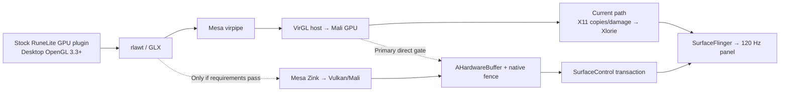

# Tablite 120 FPS Optimization and Frame-Telemetry Plan

Status: approved implementation plan  
Primary device: stock, unrooted Samsung Tab S10 Ultra (SM-X920)  
Target output: native 2960×1848 landscape at 120 Hz  
Recorded: 2026-07-28

## Summary

The first milestone targets the connected stock, unrooted Samsung Tab S10 Ultra/SM-X920 at native 2960×1848 landscape output:

- At least 118 unique presented frames per second for two minutes.
- No more than 1% missed 8.33 ms presentation deadlines.
- No stall over 50 ms.
- Current AA, draw distance, UI scale, and other visual settings remain unchanged.
- Detailed captures remain local: a lightweight on-device flight recorder plus host-pulled Perfetto, JFR, Mali, and frame-correlation bundles.
- Developer options and ADB profiling are permitted, but no runtime solution may require root, custom SELinux policy, system-partition edits, or private Android APIs.

RuneLite’s client, gamepack, GPU plugin, and Java plugin code remain byte-identical to upstream. Changes are permitted in Tablite, rlawt native bridges, LWJGL native compatibility/loading, Mesa, VirGL, X11/Xlorie, and Android presentation.

Before further runtime optimization, the project must pass the canonical
architecture and lint gate documented in
`docs/architecture/application-architecture.md`. Strong rules are enabled
without a debt baseline, every exposed violation is fixed, and the analyzer
must attribute each check's runtime while completing in less than 60 seconds.
This prerequisite locks the DI, telemetry, frame-metric, process, source
ownership, and RuneLite-integrity seams used by the remainder of this plan.

The implementation begins with two parallel tracks:

1. Build the end-to-end frame flight recorder and decompose the proven native-X11/VirGL path.
2. Run a bounded feasibility spike for desktop-GL/VirGL output → AHardwareBuffer → SurfaceControl.

If the measured X11 path retains a serialized stage above the 8.33 ms service budget after its highest-confidence optimization, the direct presentation route becomes the primary effort rather than continuing indefinite X11 tuning.

## Research-Backed Architecture

- The current RuneLite GPU plugin creates LWJGL desktop-OpenGL capabilities and hard-requires OpenGL 3.3; it is not a GLES renderer. See [GpuPlugin.java](https://github.com/runelite/runelite/blob/02b41869adaf688c1f6f0bec63f1a18aa57a1c64/runelite-client/src/main/java/net/runelite/client/plugins/gpu/GpuPlugin.java#L268-L317).
- Android’s public NDK driver interface provides OpenGL ES, not desktop OpenGL ([NDK graphics APIs](https://developer.android.com/ndk/guides/stable_apis)).
- The experimental direct producer currently creates a GLES context in `third_party/rlawt/rlawt_android.c`. Fixing its present linker failure would therefore reveal a second, fundamental OpenGL capability failure.
- The proven native-Termux/X11 path has already run the stock GPU plugin through Mesa/VirGL. It remains the control and starting point.
- Android publicly supports direct HardwareBuffer submission with acquire and release fences through [`SurfaceControl.Transaction.setBuffer`](https://developer.android.com/reference/android/view/SurfaceControl.Transaction#setBuffer(android.view.SurfaceControl,%20android.hardware.HardwareBuffer,%20android.hardware.SyncFence,%20java.util.function.Consumer)).
- Zink can provide desktop OpenGL over Vulkan, but only if the exact Mali Vulkan driver passes Mesa’s current feature profiles and functional tests ([Mesa Zink](https://docs.mesa3d.org/drivers/zink.html)).

Current evidence shows the panel is not the initial ceiling:

- Android Choreographer and the panel ran near 120 Hz while RuneLite/Xlorie content remained around 26–28 FPS.
- Native gameplay captures recorded `glXSwapBuffers` commonly taking roughly 27–38 ms, already several times the full 8.33 ms interval. See `runelite-tablet/docs/logs/pipeline-observability.md`.
- The latest direct attempt produces no GPU frames because Android’s private GLES dependency cannot load from the Termux linker namespace. See `_tmp_runelite_native_current2.log`. This is not safely solvable by relying on additional private system libraries.

## Phase 0 — Preserve and Freeze the Starting Point

- Checkpoint the current dirty direct-surface prototype unchanged before overlapping work. Keep whole files intact when forming commits and never add co-author trailers.
- Treat the following as independent lanes:

  - `native_x11_virgl_gpu`: primary proven baseline.
  - `proot_x11_virgl_gpu`: legacy comparison.
  - `direct_virgl_ahb`: experimental target.
  - `direct_zink_ahb`: gated alternative.
  - `software_x11`: correctness/fallback control only.

- Capture one archival run with the currently installed RuneLite build.
- Update through the project’s normal official RuneLite flow, record all JAR/native hashes, and freeze that exact version for the optimization campaign. Client upgrades must never be mixed into a renderer A/B.
- Add an artifact-integrity manifest that proves:

  - RuneLite client, gamepack, GPU plugin, and plugin classes match official artifacts.
  - Patched rlawt/LWJGL JARs retain upstream Java-class hashes.
  - Only explicitly listed native compatibility payloads differ.
  - No gameplay automation, protocol changes, or modified RuneLite plugin behavior exists.

- Redact credentials, tokens, account identifiers, and authentication JVM properties before expanding telemetry. Bundles must not collect chat text, typed keys, screenshots, or gameplay packet contents.
- Correct known observability defects before trusting new baselines:

  - Rename the Android Choreographer metric to `host_vsync_callback_rate`; it is not game FPS.
  - Replace the 12 ms jank threshold with target-rate-aware deadlines.
  - Reset all frame history on session changes.
  - Stop labeling a run CPU- or IPC-bound solely from rlawt gap/swap ratios.
  - Fix direct buffer-index and sequence logging.
  - Fix stale GPU-query frame attribution.
  - Capture Xlorie wait reason before sleeping.
  - Add a renderer heartbeat independent of successfully rendered frames.
  - Surface all dropped telemetry events instead of silently evicting them.

## Phase 1 — Build the Frame Flight Recorder

Implementation checkpoint (2026-07-28):

- rlawt SUMMARY mode now emits `RLT_FRAME_RATE_V1` from exact, monotonic
  post-swap sequence intervals. The app and host analyzer independently
  recompute the rate and reject inconsistent, duplicate, reordered,
  overlapping, stale, or cross-run windows.
- The app dashboard reports `produced_fps` only from that producer sequence.
  `accepted_fps` remains unavailable because no honest acceptance boundary
  exists. `submitted_fps` and `presented_fps` are exposed only when Xlorie's
  source identity is `producer_seq`, the run IDs agree, Android display
  timestamps are supported, and all correlation error counters are zero.
- Xlorie redraws, Choreographer callbacks, X11 damage/Present activity,
  BufferQueue activity, release callbacks, and synthetic glxgears output are
  explicitly named stage rates in hertz. They cannot be promoted to FPS by
  the canonical analyzer.
- Presentation-rate correlation for the native X11 path is complete. rlawt
  sends `_RLT_FRAME_SEQ_V1` as an ordered property request on the same X11
  connection immediately before swap; Xlorie attaches that sequence to
  coalesced damage, EGL submission, and the actual Android display-present
  timestamp. Exact per-frame waterfall export remains incomplete and is
  labeled separately from the now-valid canonical presentation rate.
- The SM-X920 supports `EGL_ANDROID_get_frame_timestamps`, including actual
  display-present timestamps. Xlorie now keeps raw submissions/present events
  separate from unique X11-source submissions/presentations and counts
  duplicate or missing source ordinals. These source-ordinal rates remain
  diagnostic until they are joined to rlawt producer sequences.
- The VirGL path does not invoke the instrumented X server GLX swap hook.
  Coalesced X11 damage remains the first proven server-side pixel boundary.
  The ordered property marker provides identity, not acceptance, so the
  analyzer continues to reject any attempt to infer `accepted_fps`.
- The callback registration is keyed to Xorg `serverGeneration`. Xorg clears
  callback lists on reset while translation-unit static storage survives; a
  process-lifetime registration boolean previously left live markers on the
  RuneLite window but no active consumer after startup resets. Producer
  sequence history and error counters now reset with each generation.
- The post-fix 10-second SM-X920 capture
  `perf-captures/20260728-124735-ce9a6b5c-529a-4a42-8f23-33bf4f9cf1cc`
  recorded 20.999 produced FPS, 21.009 submitted FPS, and 21.005 uniquely
  presented FPS. It correlated 216 producer identities to 216 unique
  submissions and 216 actual display presentations with zero duplicates,
  missing events, marker errors, timestamp errors, or telemetry loss.
- That capture localizes the current ceiling before X11 damage. The rlawt
  swap boundary averaged 36.885 ms across summary-window means, the worst
  window p95 was 52.164 ms, and the observed maximum was 56.254 ms. Those
  are summary-window statistics rather than reconstructed raw-frame
  percentiles. The internal VirGL transport, GPU execution, and fence-wait
  contributions remain unresolved.
- A later untouched 10-second checkpoint,
  `perf-captures/20260728-124934-ce9a6b5c-529a-4a42-8f23-33bf4f9cf1cc`,
  fell to 15.198 produced and 14.965 uniquely presented FPS while retaining
  perfect 153/153 producer-to-display correlation. The swap window mean rose
  to 44.437 ms and its worst window p95 to 58.588 ms. Android thermal status
  remained `0` with 31.8 °C skin temperature, so this sample does not support
  thermal throttling as the cause. Workload/scene variation and the unresolved
  swap interior must be separated in the controlled campaign.
- X11 still copied 3,274,021,296 bytes during this checkpoint, totaling
  384.893 ms of CPU copy time with a 5.413 ms maximum copy. The
  marker-receive-to-damage p95 was 8.566 ms and damage-to-redraw p95 was
  0.757 ms. The full-frame copy remains a material secondary seam, but it is
  not large enough by itself to explain the 44.437 ms swap boundary.
- The GLX acceptance hook remains absent, so accepted-to-damage latency is
  explicitly unavailable rather than reported as a misleading zero. The
  observed damage-to-redraw aggregate was 0.316 ms p50 and 0.522 ms maximum.
- Startup samples proved that repeated source submissions do occur: their
  redraw-reason masks identified cursor-only or mixed initialization work.
  Raw EGL and compositor rates must never be used as gameplay FPS because
  they can include repeated old content.
- Script deployment now streams the 236,553-byte generated batch through
  `bash -s` stdin instead of placing it in Android process arguments. The
  real device deployed all 22 scripts in one 558 ms IPC call with no
  `E2BIG` and no serial fallback.
- Canonical analyzer rules `TBL013` and `TBL014` preserve the ordered
  producer-to-presentation identity and stdin deployment transport. The full
  analyzer completed in 47.565 seconds; its architecture checks completed in
  0.422 seconds, both within their enforced budgets.

### Shared identity and clock contract

- Generate a random `run_id` in the Android app and pass it to the launcher, rlawt, Mesa/VirGL telemetry, Xlorie, and host collector.
- Use `CLOCK_MONOTONIC` in native components and `System.nanoTime()` in Java/Kotlin.
- Record boot ID plus realtime, monotonic, and boottime clock anchors at capture start.
- Perform a producer/consumer clock handshake and record round-trip uncertainty.
- Generate a 64-bit `frame_seq` at the rlawt frame boundary:

  - `previous swap return → current swap entry` is the externally observable frame-generation interval.
  - Swap blocking, GPU completion, transport, presentation, and buffer release remain distinct spans.
  - Direct transport carries `frame_seq` explicitly.
  - X11 uses matching per-client/window GLX swap ordinals. Validate exact agreement over 10,000 synthetic swaps; add a same-connection ordered marker only if ordinals diverge.

### Event schema

Every `FrameEventV1` contains:

- Schema version, run ID, backend, process/thread IDs.
- Frame sequence, buffer index, pool generation, and X11/EGL/SurfaceControl frame identifier.
- Stage and event enums.
- Monotonic begin/end and thread CPU time.
- Dimensions, stride, damaged pixels, bytes transferred, commands, queue depth, and configuration hash where relevant.
- Status such as presented, duplicate, superseded, dropped, starved, timed out, unsupported, or telemetry lost.

Every instrumented API handoff must emit or aggregate:

- The incoming and outgoing `frame_seq`, plus any API-native frame, fence,
  buffer, resource, connection, window, or transaction identifier.
- Monotonic begin/end time and calling-thread CPU time.
- Input/output bytes, commands, damage pixels, dimensions, format, and
  configuration hash when the handoff can transform data.
- Queue depth and oldest-item age before and after the call.
- Wait reason and wait duration, including socket, fence, lock, condition,
  dequeue, acknowledgment, compositor, and buffer-release waits.
- Outcome and ownership transfer: accepted, submitted, completed, dropped,
  duplicated, superseded, timed out, unsupported, or telemetry lost.

Instrumentation escalates locally. SUMMARY first identifies the largest
serialized stage. BURST then records that stage's API handoffs. Only the
specific slow handoff is expanded with DEEP counters or traces. A downstream
rate may never be substituted for a missing upstream or presentation event.

Define rates separately:

- `produced_fps`: distinct rlawt producer frames.
- `accepted_fps`: distinct frames accepted downstream.
- `submitted_fps`: distinct EGL swaps or SurfaceControl transactions.
- `presented_fps`: distinct producer sequences confirmed on-screen.
- `display_vsync_hz`: physical panel cadence.
- `frame_age`: producer boundary to actual presentation.

### Telemetry modes

- `OFF`: clean benchmark with no frame recorder.
- `SUMMARY`: lock-free counters and histograms.
- `BURST`: fixed-size in-memory per-frame ring retaining five seconds before and after a detected miss or stall.
- `DEEP`: short invasive diagnostics using JFR, AGI, VirGL/API traces, `glFinish`, or XSync.

Hot paths may not perform file I/O, logcat calls, stack-trace allocation, blocking export, or per-frame string formatting. Fixed-size binary records go into bounded rings and background workers flush batches. If full, telemetry is dropped and counted; rendering is never blocked.

## Phase 2 — Instrument the Complete Pipeline

| Layer | Required frame telemetry | Burst/deep additions |
|---|---|---|
| RuneLite JVM without changing RuneLite | Client/AWT thread CPU versus wall time, runnable/blocked/parked state, inter-swap frame-generation period | JFR execution samples, GC, safepoints, JIT, allocations, locks, socket waits; optional GL-call interposer |
| rlawt/Mesa guest | AWT/JNI lock time, GL flush, asynchronous fence insert/signal, swap entry/return, context changes and errors | `glFinish`/XSync only in DEEP mode; timer queries only when genuinely supported |
| Virpipe/vtest | Commands and bytes per frame, socket write blocking, read/ack time, flush/fence round trips, outstanding queue depth | Packaged VirGL trace backend after verifying it is built |
| VirGL host | Receive, decode, submit, resource copy, host-fence create/signal, queue depth and resource format | AGI/Mali counters and command-level trace |
| X11/Xlorie | Swap ordinal, PutImage calls/bytes, memcpy time, damage rectangles/pixels, Present attempt/rejection, signal-to-wake, AHB lock/upload/draw, fence wait, EGL swap | Request-level capture and detailed copy attribution |
| Direct AHB | Producer complete, acquire-fence creation, ready send/receive, SurfaceControl submit, latch, present, release callback/fence, reuse and pool wait | Fence-lifetime validation and GPU-copy profiling |
| Android display | Actual refresh mode, target present, latch, present-fence signal, missed deadline, jank type and mode changes | Perfetto SurfaceFlinger/frame lifecycle and AGI |
| CPU/GPU/system | Per-thread runtime, migrations, runnable delay, current CPU/frequency, cpuset/uclamp, context switches, GPU busy/frequency and thermal headroom | Perfetto scheduling/frequency/idle and Mali hardware counters |
| Lifecycle/input | Resize generation, pause/resume, buffer-pool lifetime, FD counts; timestamp and broad input category only | Optional later high-speed-camera latency validation |

Under the no-RuneLite-change boundary, exact begin/end spans inside `GpuPlugin.draw()` are unavailable. Use JFR for statistical Java attribution and a project-owned native GL wrapper for call counts, bytes, maps, uploads, draws, blits, flushes, and readbacks. Reports must label sampled/inferred values honestly.

### Presentation ground truth

- For Xlorie EGL output, use `eglGetNextFrameIdANDROID` before swap and map it to `frame_seq`.
- Query supported render-complete, latch, composition, display-present, dequeue-ready, and reads-done timestamps via [`EGL_ANDROID_get_frame_timestamps`](https://registry.khronos.org/EGL/extensions/ANDROID/EGL_ANDROID_get_frame_timestamps.txt).
- Upgrade `compileSdk` to 36 while retaining `targetSdk` 35 during the campaign.
- On Android 16, register [`SurfaceControl.OnJankDataListener`](https://developer.android.com/reference/android/view/SurfaceControl.JankData) for app/composer/other classification, scheduled versus actual frame time, and vsync ID.
- Capture Perfetto scheduler, frequency/idle, SurfaceFlinger, frame lifecycle, memory, and thermal tracks.
- Capture Mali GPU counters through AGI when supported. Unsupported counters remain explicitly unavailable.
- Use Perfetto FrameTimeline only as a cross-check because its documentation notes incomplete SurfaceView coverage.

## Phase 3 — Local Capture Bundles and Analysis

The selected telemetry architecture is:

- Lightweight SUMMARY recorder available on-device.
- Short BURST capture triggered around jank.
- Host-pulled detailed bundle for serious analysis.
- No telemetry backend or player upload during this phase.

A single host command starts/stops all collectors and produces:

- `manifest.json`: build and dirty hashes, APK/JAR/native hashes, RuneLite version, backend, GPU settings, Mesa/VirGL/GL/EGL/Vulkan versions, device fingerprint, display mode, dimensions, thermal state and workload.
- Per-process binary traces with event/drop counts.
- `system.perfetto-trace`.
- Optional JFR and AGI artifacts.
- Redacted launcher/client logs.
- `frames.csv`: joined frame waterfalls.
- `summary.json` plus a local HTML or Markdown report.
- `sha256sums.txt`.

The analyzer reports:

- Produced, accepted, submitted, and uniquely presented FPS.
- p50/p90/p95/p99/max per stage.
- Deadline misses, consecutive misses, duplicates, drops, starvation and frame age.
- Queue depth/age, socket blocking, commands/bytes, copy bytes and damaged pixels.
- Top slow frames with simultaneous JVM, scheduler, GPU, compositor and thermal evidence.
- Bottleneck classification: producer CPU, JVM pause, scheduler, VirGL transport, GPU execution, X11 copy, consumer fence, BufferQueue/compositor, thermal, or unknown.
- Correlation confidence and unmatched events. Below 99.9% correlation invalidates exact attribution.
- Telemetry’s own CPU time, queue high-water mark, flush time and lost-event count.

The in-app dashboard reads one-second aggregates only; it never processes raw frame events on the render/presentation thread.

## Phase 4 — Controlled Benchmark Campaign

Freeze native 2960×1848 output and the current AA, draw distance, UI scale, and related visual settings.

For 60, 90, and 120 FPS targets:

- Begin from a comparable thermal band.
- Warm up for 30 seconds.
- Run three two-minute captures.
- Hold RuneLite version, renderer build, scene, camera, brightness, charging state and configuration constant.
- Separate:

  - Login/static UI.
  - Varrock East Bank steady gameplay.
  - Marked manual camera movement and menu interaction.
  - Map-loading transition.
  - 10–15 minute thermal soak.

- Do not mix startup/loading and steady-state statistics.
- Quality and resolution sweeps may confirm whether the workload scales, but they cannot count toward the milestone because prior testing showed they did not resolve the problem and the visual configuration is now frozen.
- Compare OFF, SUMMARY, and BURST modes before trusting telemetry. SUMMARY overhead must remain below both 2% throughput and 0.2 ms p95. DEEP traces are never used for final FPS claims.

Use a synthetic ladder:

1. Android-only SurfaceControl/AHB native-resolution producer.
2. Cross-UID AHB and fence transport.
3. Desktop-GL 3.3 RuneLite-like PBO/BGRA/FBO/MSAA/blit workload through VirGL.
4. Full native-X11/VirGL/Xlorie.
5. Stock RuneLite GPU plugin in the controlled gameplay workload.

The first rung that fails identifies the newly introduced ceiling.

## Phase 5 — Evidence-Driven Optimization of the Existing Path

Make one change per experiment and require three paired runs.

- JVM/producer dominant:

  - Use JFR to separate CPU work, GC, JIT, locks, parks, pacing and socket waits.
  - Remove launcher/logging work from hot threads.
  - Measure RuneLite’s UI PBO/upload cost indirectly through sampling and GL-call telemetry; do not patch the plugin.
  - Test JVM flags or thread priority individually.

- Scheduler dominant:

  - Correct the exact hot thread’s cpuset, priority or runnable-delay problem.
  - Verify placement again after 30 seconds rather than trusting launch-time affinity.
  - Do not pursue utilization or big-core pinning without evidence; prior results show low utilization can coexist with serialized waits.
  - Android performance hints apply only to app-owned threads.

- VirGL dominant:

  - Reduce synchronous waits and round trips.
  - Batch vtest commands and measure threaded submission.
  - Eliminate avoidable readbacks.
  - Adjust socket sizing only after proving socket blocking.
  - Run the complete GL correctness suite after every Mesa/VirGL change.

- Mali GPU dominant:

  - Correlate frame fences with tiler, fragment, bandwidth, cache, occupancy, clock and thermal counters.
  - Determine whether the cause is fill rate, bandwidth, uploads, translation or throttling.
  - If GPU execution itself cannot sustain an 8.33 ms service interval at frozen quality, document the measured hardware ceiling.

- X11 copy/damage dominant:

  - Quantify PutImage fragmentation, bytes, memcpy time and Present rejections.
  - Repair DRI3/Present or AHB/DMA-BUF interoperability.
  - Coalesce damage and remove redundant fullscreen CPU/GPU copies.
  - Probe presenting Xlorie’s existing root AHB through SurfaceControl as an intermediate improvement.

- Xlorie/compositor dominant:

  - Use the game-appropriate default frame-rate compatibility hint rather than fixed-source video compatibility.
  - Verify actual refresh mode after every request.
  - Use explicit acquire/release fences and desired presentation timing.
  - Pace to Choreographer frame timelines rather than stuffing BufferQueue.

### Escalation rule

After the flight recorder covers the entire current path, perform the highest-confidence optimization against the largest serialized p95 stage.

Shift the majority of effort to the direct path when either is true:

- A required X11/Xlorie service point remains above 8.33 ms p95 and cannot overlap with adjacent stages.
- The current path still shows monotonically growing queues or repeated multi-refresh blocking after that optimization.

This implements the selected “telemetry plus bounded spike, then direct-first if necessary” strategy.

## Phase 6 — Direct Desktop-GL/AHB Presentation

### Gate A: SurfaceControl primitive

Create a child SurfaceControl parented to the host SurfaceView.

Prove it can:

- Accept HardwareBuffers with composer-overlay, GPU-sampled-image and GPU-color-output usage.
- Accept producer acquire fences.
- Return release callbacks/fences before reuse.
- Report latch time and presentation-fence signal time in `CLOCK_MONOTONIC`.
- Sustain 10,000 native-resolution frames plus 100 resize/pause/resume cycles without corruption, crashes, FD growth or use-before-release.

This eliminates the current consumer fullscreen GLES blit.

### Gate B: VirGL final-frame export — primary route

- Locate the actual resolved color resource at the GLX/Xorg/VirGL boundary.
- Extend the existing DMA-BUF probe to cover Android import, pixel correctness, native fences, full-size triple buffers, cross-UID lifetime and 10,000-frame stability.
- Initially permit a measured host-side copy from the completed VirGL image into an AHB-backed image.
- Then attempt rendering directly into an importable AHB-backed target to remove that copy.
- Export `frame_seq`, buffer index, pool generation and acquire-fence FD.
- Shut down X11/Xlorie only after traces prove no presentation dependency remains.
- Promote this route when it reaches the next 60/90/120 rung or improves end-to-end p95 by at least 20% without adding a frame of latency.

### Gate C: Zink alternative

Replace the old three-feature test with Mesa’s complete `zink_check_requirements` profile.

Require, without version overrides:

- Real OpenGL 3.3 capability and entrypoints.
- Correct RuneLite-like shaders, BGRA/PBO uploads, FBO, MSAA, resolve and blit.
- AHB/external-memory interop.
- Native-fence import/export.
- Resize/lifecycle correctness.
- 10,000 frames with no GL errors, corruption or instability.

If any requirement fails, close Zink for this device and retain VirGL. Do not implement a custom GLES version of RuneLite or alter its shaders.

### Direct protocol v2

- Handshake carries run ID, capabilities, clock anchor, dimensions, format and pool generation.
- `FRAME_READY` uses a 64-bit sequence and carries producer timestamps plus an acquire-fence FD.
- `RELEASE` validates sequence/index/generation and carries presented/dropped state, latch/present/release timestamps and release fence.
- Use a bounded triple-buffer mailbox.
- If behind, present the newest safe frame and report older frames as `DROP_SUPERSEDED`.
- Never reuse a buffer before its release fence signals.
- Protocol v1 remains for isolated probes only; unsupported v2 capabilities fall back to native X11.

## Interfaces and Types

- `RendererBackend`: `NATIVE_X11_VIRGL`, `DIRECT_VIRGL_AHB`, `DIRECT_ZINK_AHB`, `SOFTWARE_X11`.
- `TelemetryMode`: `OFF`, `SUMMARY`, `BURST`, `DEEP`.
- Stable shared numeric enums for `FrameStage`, `FrameOutcome`, and `BottleneckClass`.
- Versioned `FrameEventV1`, `CaptureManifestV1`, and direct protocol-v2 structures.
- Standard launcher inputs:

  - `RLT_CAPTURE_ID`
  - `RLT_TELEMETRY_MODE`
  - `RLT_RENDERER_BACKEND`
  - `RLT_TARGET_HZ`
  - `RLT_CAPTURE_DIR`

- Replace the currently inconsistent app and Termux direct-mode sentinels with this single backend selection.

## Verification and Acceptance

### Automated

- Schema round trips and compatibility.
- Ring wrap, overflow, drop accounting and percentile correctness.
- Clock calibration and synthetic multi-process joins.
- Sequence propagation and GLX ordinal agreement.
- Missing, duplicate, stale, reordered and superseded frames.
- Protocol-v2 fence transfer and ownership.
- Buffer reuse only after release.
- Pool replacement, resize, pause/resume, process death, teardown and FD leaks.
- EGL timestamp pending/invalid handling.
- Synthetic known-stall bottleneck classification.
- Secret-redaction and bundle-content tests.
- RuneLite artifact/class integrity verification.

### Real device

Every runtime-impacting change must be verified on the stock, unrooted SM-X920.

The milestone requires, in three independent two-minute runs:

- Native 2960×1848 output with frozen visual settings.
- Stock RuneLite GPU plugin remains enabled with valid desktop GL and no fallback.
- Physical display remains at 120 Hz.
- At least 118 unique producer frames confirmed presented per second.
- No more than 1% missed deadlines.
- p95 unique inter-present time within one refresh plus timestamp tolerance.
- No stall over 50 ms.
- Queue depth bounded at two or less without growth.
- Drops, duplicates and starvation below 1%.
- At least 99.9% frame correlation and zero unreported telemetry loss.
- SUMMARY telemetry stays within its 2%/0.2 ms budget.
- Less than 5% sustained throughput loss during the thermal soak.
- Correct input, resize, pause/resume, background/foreground, shutdown and RuneLite-update behavior.

GPU-off rendering is used only when the GPU plugin fails a correctness or stability gate on a device. Failure to reach 120 through one route is not sufficient reason to disable it.

Keeping RuneLite byte-identical is an engineering boundary, not a separate guarantee that a custom Android wrapper has Jagex/RuneLite distribution approval; that policy question must be confirmed before public distribution.

## Actionable Phased Order — 2026-07-28 Audit

This order supersedes the numeric execution order above while preserving its
requirements and acceptance gates. The earlier sections remain the design and
evidence record; this section is the working backlog.

### Working Phase 1 — Split the serialized swap boundary

Status: **Phase 1A complete; Phase 1B in progress after Working Phase 2**

Objective: divide the observed 44–59 ms rlawt swap boundary into VirGL/vtest
command transport, host driver/GPU execution, and fence/completion waits before
changing renderer behavior.

Actions:

1. Freeze the active host implementation's provenance: Termux package
   `virglrenderer-android` 1.3.0, upstream virglrenderer 1.3.0 source archive,
   package recipe, installed binary SHA-256, Android NDK identity, and runtime
   FD/thread topology.
2. Add an opt-in DEEP syscall seam capture for the active VirGL worker. Record
   vtest Unix-socket reads/writes, Mali ioctls and event waits, native
   `sync_file` polls, futex waits, thread identity, call duration, and payload
   bytes. Keep it outside benchmark modes because ptrace is invasive.
3. Analyze that trace without treating overlapping worker-thread time as
   additive or equating driver ioctl time with GPU execution time.
4. Use the observational capture to decide whether the installed VirGL binary
   is still an unresolved dominant seam. Do not vendor or modify VirGL merely
   because its internals are available.
5. Only if the observational data cannot bound the cause, or identifies VirGL
   as the dominant seam, pin and vendor upstream virglrenderer 1.3.0 and the
   matching Termux recipe. Rebuild it with project-owned, fixed-cost counters at
   vtest receive/decode, renderer submit, fence-create, and fence-signal
   boundaries.
6. If source-level VirGL telemetry is required, carry `run_id` and the current
   producer sequence into its summaries. Export exact detail events only in
   BURST/DEEP mode.
7. Run three comparable short captures and report p50/p95/max, queue depth,
   commands, bytes, socket blocking, host submit, and fence completion.

Exit gate:

- At least 99.9% of captured producer sequences have an unambiguous VirGL
  boundary assignment, or every remaining unattributed interval is explicitly
  bounded.
- The largest serialized p95 substage is identified without summing overlapping
  thread time.
- OFF remains unchanged; SUMMARY overhead is below 2% throughput and 0.2 ms
  p95.

Current first slice:

- Provenance and the opt-in DEEP syscall seam capture are the first
  implementation slice. They are diagnostic scaffolding, not the final
  source-level attribution required by this phase's exit gate. VirGL remains
  the installed Termux package unless this slice demonstrates that vendoring or
  patching it is necessary.
- `scripts/capture-virgl-seams.ps1` and `tools/virgl_seams.py` now implement
  this slice. The capture attaches only to the active VirGL worker and records
  vtest Unix-socket I/O, Mali ioctls/events, GED ioctls, eventfd activity,
  native-fence polls, futex waits, FD/thread topology, package hashes, and
  bounded realtime-to-monotonic clock anchors. The analyzer reconstructs
  unfinished/resumed syscalls, keeps main-thread time separate, and states that
  cross-thread time overlaps. Syscall strings are truncated to one byte, byte
  counts come from return values, and exported text passes the canonical
  credential/gameplay-content redactor.
- The real-device verification bundle
  `perf-captures/20260728-131018-ce9a6b5c-529a-4a42-8f23-33bf4f9cf1cc-virgl-seams`
  captured 2.986 seconds from the unchanged Termux
  `virglrenderer-android` 1.3.0 binary. It observed 1,030 candidate-vtest
  socket calls carrying 255,619 bytes, 388 Mali ioctls, 57 main-thread
  zero-time native-fence probes, 58 worker fence waits, and separate
  Mali/eventfd completion activity. The clock-anchor uncertainty was 1,231 ns
  at start and 1,769 ns at end with 38 ns measured offset drift.
- This DEEP run is not bottleneck-selection evidence: ptrace materially
  perturbed the workload. Its producer summary was 14.178 FPS with a 55.574 ms
  swap-window mean, and later one-second presentation windows fell to roughly
  9.6–9.9 FPS. The trace establishes seam topology and capture feasibility
  only. Phase 1 must next carry producer identity through a lower-overhead
  SUMMARY/BURST path before deciding whether VirGL needs to be vendored or
  changed.

Phase confirmation:

- Phase 1A, the provenance/topology/DEEP feasibility slice, is complete. Its
  implementation, tests, and physical-device evidence are retained above.
- The full Working Phase 1 exit gate is not complete. The invasive trace did
  not carry producer identity into VirGL, cannot assign 99.9% of producer
  sequences, and cannot select the largest serialized p95 substage.
- Phase 1B is intentionally deferred until the canonical observability nervous
  system below exists. This is a dependency correction, not a loss or
  reclassification of the completed Phase 1A work.

Phase 1B resume checkpoint (2026-07-28):

- Working Phase 2 has met its exit gate, so Phase 1B has resumed without
  changing or vendoring VirGL.
- The existing cross-UID native telemetry adapter now normalizes and accepts
  only declared bounded `RLT_FRAME_RATE_V1` and `RLT_VIRGL_WORKER_V1`
  summaries. Accepted records enter `AppLog`, its sanitizer, catalog, retained
  cursor store, and authenticated `/v1` endpoint. The architecture lint
  requires both record types and their canonical routing; adding a parallel
  renderer endpoint is not permitted.
- `scripts/capture-virgl-summary.ps1` and
  `tools/virgl_worker_summary.py` add a non-ptrace procfs sampler. It identifies
  the active Mali-owning VirGL worker, validates PID start identity, samples
  per-thread `schedstat`, state, CPU, and wait-channel data, reports its own
  CPU cost, forwards one bounded worker summary, and joins it to producer
  sequence windows from the canonical retained log. It never captures input,
  screenshots, gameplay packets, or raw client logs and does not modify the
  VirGL binary.
- The first 20 ms BURST proof measured its own cost at 17.684% of one core
  (2.2105% of eight-core device capacity), so it is explicitly unsuitable for
  SUMMARY mode. This was a useful observer-effect rejection, not benchmark
  evidence.
- The lower-cost physical-device bundle
  `perf-captures/20260728-135531-bf8d2c28-d738-4170-b1af-15705a98ee85-virgl-summary`
  sampled at 100 ms for 8.001 seconds. The sampler used 2.5896% of one core,
  or 0.3237% of device CPU capacity. It delivered six valid producer windows
  and one VirGL worker record through the canonical endpoint with zero log
  gaps or drops.
- Five fully contained producer windows covered 150 sequence intervals at an
  aggregate 23.575 produced FPS. During the same monotonic window the VirGL
  worker consumed 58.9445% of one core; its main thread accumulated
  597.563 ms of runqueue delay and 2,835.867 ms of blocked-or-idle time.
  Wait-channel samples were primarily running, `do_select`, and
  `do_sys_poll`.
- This narrows the next question but does not close Phase 1B. Procfs can
  distinguish running, scheduler-delayed, and blocked/idle time, but cannot
  label blocked time as vtest transport, host GPU execution, or fence
  completion. Correlation is producer-summary-window level, not per-frame, so
  the 99.9% assignment exit gate remains unmet.
- The exact guest seam is now pinned without modifying it. The repository's
  Termux Mesa recipe selects Mesa 25.2.8 and its archive SHA-256
  `097842f3e49d996868b38688db87b006f7d4541e93ce86d2f341d8b3e7be7c93`;
  a fresh archive matched that hash. In
  `src/gallium/winsys/virgl/vtest`, `virgl_vtest_winsys_submit_cmd`
  exposes command dword count, `virgl_vtest_submit_cmd` performs the header
  and payload socket writes, and `virgl_vtest_busy_wait` performs the request
  writes plus blocking response reads.
- The same Mesa path exposes an even more specific swap seam:
  `virgl_vtest_flush_frontbuffer` calls
  `virgl_vtest_transfer_get_internal`, which sends a transfer-get request,
  performs a blocking resource busy-wait, copies the resolved shared resource
  into the display target with `util_copy_rect`, and then calls
  `displaytarget_display`. These are the next four timing boundaries. They can
  separate guest command transport, completion wait, CPU copy, and X11 display
  handoff before any VirGL server patch.
- Next implementation slice: add an opt-in patch to the project-owned Termux
  Mesa 25.2.8 recipe, not VirGL. A launcher-created shared telemetry page will
  let rlawt publish the active producer sequence before `glXSwapBuffers` and
  clear it afterward. Mesa will attach that identity to fixed-cost counters for
  submit header/payload writes, transfer-get request, busy-wait response,
  `util_copy_rect`, and `displaytarget_display`. SUMMARY exports bounded
  windows through the canonical native ingress; BURST uses a fixed binary ring.
  Only if these guest-side boundaries leave a dominant unbounded host interval
  will the plan vendor or patch VirGL.

### Working Phase 2 — Canonical agent observability nervous system

Status: **complete**

Objective: give the app, host tooling, and AI agent one truthful, bounded,
read-only control plane for live logs, production-derived state, telemetry
summaries, loss accounting, and evidence capture before adding more renderer
seams.

Field Guide audit conclusions preserved on 2026-07-28:

- Reuse the compact observability spine, not the Field Guide product driver.
  Do not port its form automation, Supabase synchronization, PostHog upload,
  multi-actor orchestration, destructive actions, or screenshot workflows.
- Field Guide separates a bounded run-scoped log channel from an authoritative
  state channel. Its logs use cursor pages; its state uses SSE with generation,
  monotonic revision, replay, reset, heartbeat, bounded subscribers, freshness,
  sentinels, and derived posture.
- Production owners remain authoritative. The diagnostics layer projects their
  current state and derives posture; it may not create mutable test-only state.
- Host waits use monotonic deadlines, stability windows, explicit terminal
  states, timeout evidence, and fail-closed handling of cursor/revision gaps.
- Every event crosses one public observability facade, one sanitizer, one event
  catalog, and one bounded transport. Static audits reject boundary drift and
  undeclared events.

Tablite-specific findings:

- `AppLog` and `DebugLogServer` already provide Logcat, local file, and live
  WebSocket output. Preserve `/ws` compatibility, but make `/v1` the canonical
  agent contract.
- The old stream retained no replay window, exposed no cursor or gap contract,
  did not authenticate a run, bound an unspecified address, and had no
  production-state snapshot or state event stream.
- Existing `StateFlow` owners, the RuneLite session service, setup/launch
  coordinators, Hybrid X11 bridge, capture registry, and flight recorder are
  sufficient inputs for an honest initial state projection.
- Raw per-frame records remain on fixed-size binary rings. The observability
  endpoint receives bounded summaries and integrity counters only; canonical
  does not mean blocking JSON or file I/O on a render hot path.
- Termux, X11, Mesa, and possible VirGL instrumentation must join through
  sanctioned bounded adapters as their seams are added. Cross-UID logcat is not
  accepted as guaranteed delivery.

Canonical debug-only API:

- `GET /v1/capabilities`
- `GET /v1/health`
- `GET /v1/logs?after=<cursor>&limit=<1..500>`
- `GET /v1/state`
- `GET /v1/state/events` using SSE and `Last-Event-ID`
- Legacy `/ws` remains a compatibility live-log view, not the evidence source.

State contract:

- `ui`: current activity lifecycle, Tablite screen, and visible sentinel.
- `setup`: launch state plus completed, failed, total, and active setup step.
- `session`: RuneLite session state and start time.
- `render`: backend, capture run, telemetry mode, target rate, recorder/loss
  counts, and Hybrid X11 binder generation/health.
- `stateMachine`: derived posture, reasons, observation readiness, and blockers.
- Initial postures are `booting`, `setup_required`, `awaiting_auth`,
  `ready_to_launch`, `launching`, `running_x11`, `running_direct`, `stopped`,
  `idle`, and `errored`.
- Sentinels describe only Tablite-owned visible surfaces. The endpoint must
  never infer RuneLite login or gameplay state without a future authoritative,
  non-invasive source.

Canonical enforcement:

1. Bind the agent server to loopback only and require an ephemeral per-process
   bearer credential stored in app-private storage. Never print or retain the
   credential in evidence.
2. Sanitize before Logcat, file, WebSocket, retained storage, or HTTP output.
   Remove credentials, tokens, account identity, chat/input content, and
   oversized messages.
3. Retain a bounded ordered log ring with explicit cursor, eviction, drop,
   truncation, and gap metadata.
4. Publish state with a random generation, monotonic revisions, 256-event
   history, five-second heartbeats, eight subscribers, and bounded slow-client
   queues. Suppress timestamp-only changes.
5. Give host tooling authenticated capability, health, state, log, SSE, and
   fail-closed evidence capture operations without UI or gameplay interaction.
6. Add canonical analyzer rules:

   - Direct Android logging outside approved adapters is forbidden.
   - Direct server broadcast outside `AppLog` is forbidden.
   - Literal event tags must exist in the catalog.
   - Loopback, authentication, bounded storage, loss accounting, sanitizer,
     state, and route markers are required.
   - Existing native and shell seams migrate through explicit adapters; new
     structured seams may not create parallel endpoints.

Reusable Field Guide tooling:

- Adapt the bounded log store, run authentication, state publisher,
  monotonic/replay semantics, state waiter, cursor capture, redaction, evidence
  bundle, artifact contract, and gap assertions.
- Rewrite Dart state builders and postures in Kotlin against Tablite production
  owners. Keep host tooling in the repository's existing Python/PowerShell
  workflow.
- Do not import Field Guide endpoints, product names, identities, route
  catalogs, roles, or backend assumptions.

Exit gate:

- Focused Kotlin and Python protocol, sanitizer, retention, state, replay, gap,
  and lint tests pass.
- The full architecture analyzer reports zero diagnostics within its budgets.
- A debug APK builds, installs without clearing app data, and exposes all
  authenticated `/v1` routes through `adb forward`.
- A physical SM-X920 state snapshot reports a truthful posture and visible
  sentinel without clicking RuneLite, logging in, or controlling gameplay.
- A live SSE subscription receives an initial state event and heartbeat or
  subsequent production-state change.
- A host evidence bundle contains capabilities, health, state, logs, and a
  redacted public session record; it fails on any log gap or unreported drop.
- RuneLite remains running and untouched.

After this phase, extend the canonical ingress into the next unresolved
VirGL/vtest/GPU/fence seam and resume Working Phase 1B. Do not modify VirGL
until that evidence requires it. The repository already owns the matching
Termux package recipe and patch series; full upstream source vendoring remains
optional and evidence-gated.

Implementation checkpoint (2026-07-28):

- `DebugLogServer` is now a loopback-only compatibility facade plus canonical
  `/v1` agent server. A per-process 256-bit bearer credential and run ID are
  written only to app-private storage. Unauthenticated physical-device access
  returned HTTP 403.
- Every `AppLog` message is sanitized before Logcat, file, WebSocket, or
  retained storage. The canonical envelope carries schema, diagnostics run,
  optional capture run, cursor, severity, event class, fingerprint, source,
  monotonic-relative and realtime clocks, correlation ID, and bounded message.
- The retained log store is capped at 30,000 entries, 32 MiB total, 64 KiB per
  event, 500 entries and 2 MiB per page. It reports eviction, drop, truncation,
  retained ranges, requested cursor, and gaps.
- `AgentStateProjection` reads real activity lifecycle, screen, setup,
  `RuneLiteSessionService`, `HybridX11Bridge`, `CaptureSessionRegistry`, and
  frame-recorder summary owners. `AgentStatePublisher` adds generation,
  monotonic revisions, timestamp-churn suppression, 256-event replay, reset
  reasons, heartbeats, eight subscribers, and bounded slow-client queues.
- The first device query exposed a real process-restart contradiction:
  RuneLite PID 26047 and VirGL PIDs 25765/30260 survived the in-place APK
  update, but the process-local session flow reset to `idle` and
  `LaunchCoordinator.checkSession()` refused to reconcile an idle value.
  `checkSession()` now always asks the production health owner to reconcile.
  The next physical snapshot truthfully reported `running_x11`,
  `runelite_running_with_x11_binder`, `observationReady=true`,
  `launch_screen`, setup 8/8, live X11 generation 1, and the preserved session
  start timestamp.
- `tools/agent_diagnostics.py` and `scripts/agent-diagnostics.ps1` implement
  authenticated capabilities, health, cursor logs, state, SSE watch, and
  observation-only capture. Evidence capture follows every bounded log page,
  fails on gaps, drops, size/page limits, or a stalled cursor, and writes only
  a redacted public session record.
- The physical SM-X920 SSE proof delivered initial state event
  `1f6bcdf4-6f29-45c6-a961-1fee1b052f1f:1` followed by a heartbeat. No RuneLite
  login, gameplay input, screenshot, or RuneLite modification occurred.
- The retained real-device bundle
  `perf-captures/20260728-133923-234c30b8-196a-4ef0-b097-48ef0ff35f6c-agent-diagnostics`
  passed with 5,255 complete log events, `running_x11`, observation readiness,
  zero cursor gaps, zero retained-log drops, zero WebSocket drops, six JSON
  artifacts, and no private bearer credential in evidence.
- At the phase exit, twenty-three Python quality tests passed; the first
  post-phase VirGL ingress extension brings the current suite to twenty-seven.
  The complete Android debug unit suite and APK assembly passed. The full
  analyzer passed Android Lint,
  PowerShell AST, shell syntax, native clang-tidy, and every architecture rule
  with zero diagnostics. The current post-extension run completed in
  36.936 seconds; the architecture rules themselves completed in 0.481
  seconds. ShellCheck 0.9.0 ran through WSL and passed.
- New analyzer rules `TBL015`, `TBL016`, and `TBL017` enforce the canonical
  logging boundary, catalog membership, and the authenticated/bounded
  diagnostics contract. Future structured Termux, X11, Mesa, or VirGL seams
  must join through sanctioned adapters and cannot create another agent-facing
  endpoint.
- The first post-phase extension proves that rule in practice: bounded
  Termux-owned producer and VirGL worker summaries now pass through the
  existing loopback native ingress into `AppLog` and the authenticated retained
  endpoint. `TBL017` requires those record declarations, their canonical
  routing, and the dynamic `tablite.native_*` catalog namespace.

### Working Phase 3 — Establish controlled, repeatable baselines

Status: **pending**

Objective: separate scene/workload variance from renderer variance. The two
untouched captures changed from 20.999 to 15.198 produced FPS without thermal
throttling, so uncontrolled point samples cannot select an optimization.

Actions:

1. Define repeatable login/static, steady gameplay, manual interaction,
   loading, and thermal-soak protocols without automating gameplay.
2. Record three paired runs per protocol at matched thermal, brightness,
   charging, camera, renderer build, and RuneLite version.
3. Compare OFF, SUMMARY, and the short DEEP diagnostic. Do not use DEEP rates as
   benchmark results.
4. Preserve exact producer-to-display correlation and add per-frame waterfalls
   once Working Phase 1 supplies VirGL detail events.

Exit gate:

- Run-to-run median throughput variation is at most 5% for the steady protocol,
  or the remaining variance has a measured covariate.
- A frozen baseline bundle and artifact-integrity manifest are selected for
  every subsequent A/B.

### Working Phase 4 — Optimize the dominant VirGL/GPU/fence substage

Status: **pending and evidence-gated**

Objective: make one change against the largest serialized substage identified
in Working Phase 1.

Candidate actions:

- Transport dominant: remove proven round trips, batch vtest commands, or
  enable measured threaded submission.
- Host submit dominant: reduce decode/submission work and unnecessary resource
  transfers without changing GL behavior.
- GPU execution dominant: use AGI/Mali counters to distinguish tiler,
  fragment, upload, and bandwidth pressure.
- Fence dominant: remove avoidable synchronous completion waits while
  preserving resource ownership and correctness.

Exit gate:

- Three paired real-device runs show a statistically consistent improvement.
- The full desktop-GL correctness suite passes.
- No RuneLite Java/plugin/gamepack byte changes occur.

Escalation:

- If the optimized serialized p95 remains above 8.33 ms, make the direct
  VirGL/AHardwareBuffer route the primary implementation path.

### Working Phase 5 — Remove the X11 full-frame copy

Status: **pending and independently useful**

Objective: remove or overlap the measured 3.274 GB per ten-second checkpoint
copy path after the primary swap seam is understood.

Actions:

1. Attribute readback, shared-memory copy, X server pixman copy, and Xlorie
   upload separately.
2. Test stride-aware DRI3/Present or direct AHardwareBuffer/DMA-BUF ownership.
3. Preserve producer identity and explicit fences across any replacement.

Exit gate:

- Eliminate at least one native-resolution full-frame copy or reduce copy p95
  below 1 ms.
- Pixel correctness, resize/lifecycle behavior, and presentation correlation
  remain valid.

### Working Phase 6 — Complete the direct VirGL-to-AHardwareBuffer gate

Status: **primitive passed; export/import pending**

Already proven:

- Public SurfaceControl + native-resolution triple-buffer AHardwareBuffer
  presentation sustains approximately 118–120 confirmed presentations per
  second.
- Device composition, acquire/release fence reuse, 10,000-frame stability,
  100 lifecycle cycles, and flat steady-state FD count passed on the SM-X920.

Remaining actions:

1. Export or copy the resolved VirGL color resource into an importable
   AHardwareBuffer.
2. Prove cross-UID buffer and native-fence transport.
3. Measure one host copy first; attempt direct render-to-AHB only after the
   ownership path is correct.
4. Integrate direct protocol v2 with sequence/index/generation validation and a
   bounded triple-buffer mailbox.

Exit gate:

- The RuneLite-like synthetic ladder passes pixel, fence, lifecycle, and
  10,000-frame stability checks.
- The route improves end-to-end p95 by at least 20% or reaches the next
  60/90/120 Hz rung.

### Working Phase 7 — Integrate the winning presentation path

Status: **pending**

Objective: select native X11/VirGL or direct VirGL/AHB from measured gates, not
from architectural preference.

Actions:

1. Keep one canonical backend selector and a safe native-X11 fallback.
2. Remove any presentation dependency from X11 only after traces prove none
   remains.
3. Verify input, resize, pause/resume, process death, shutdown, and RuneLite
   update behavior.
4. Close Zink on this device unless its complete requirement and correctness
   profile passes without version overrides.

Exit gate:

- The selected path is stable under the full controlled workload campaign.
- No fallback, corruption, FD growth, telemetry loss, or integrity mismatch is
  observed.

### Working Phase 8 — Validate the 120 FPS milestone

Status: **pending**

Run the real-device acceptance suite above as three independent two-minute
runs plus the thermal soak. If the device cannot meet the target at frozen
quality, publish the measured hardware/software ceiling and the remaining
dominant stage rather than substituting a lower-resolution or GPU-off result.

## Latest Execution Checkpoint — 2026-07-28

Working Phase 1B guest-side attribution and host-side VirGL attribution have
passed their runtime gates. The matched telemetry-overhead comparison did not
pass its decision gate, so no optimization has been selected:

- One versioned 64-byte `RLT_FRAME_TELEMETRY_ABI_VERSION=1` page now joins
  rlawt producer sequence identity to Mesa's virpipe/vtest client. The page is
  private, run-scoped, opt-in for SUMMARY/BURST/DEEP, and contains no account,
  client-log, input, or gameplay data.
- rlawt publishes the active producer immediately around `glXSwapBuffers`.
  The Mesa 25.2.8 recipe now applies fixed-cost instrumentation for command
  submit, transfer-get request, completion wait, CPU copy, display handoff, and
  fence wait. It emits one bounded `RLT_MESA_VTEST_V1` record per 30 frames,
  including producer attribution and exact p50/p95/max stage statistics.
- Mesa summaries enter the existing native ingress, sanitizer, event catalog,
  retained cursor store, and authenticated `/v1` endpoint. `TBL017` rejects a
  missing prefix, route, ABI marker, stage, record window, or producer
  begin/end marker. No parallel renderer endpoint was added.
- `tools/mesa_vtest_summary.py` and
  `scripts/capture-mesa-vtest.ps1` fail closed on missing windows, attribution
  below 99.9%, incomplete frames, endpoint gaps, or drops. The analyzer may
  justify source-level VirGL instrumentation when completion wait dominates;
  it cannot justify a VirGL optimization patch from guest-side evidence alone.
- The project-owned Termux recipe built Mesa 25.2.8 successfully in the
  official package-builder container with source and Docker storage on WSL
  ext4. The instrumented package is 3,728,344 bytes with SHA-256
  `bd7d642228e4af1938ccf9f4a9299034e090e4d51402f5a5d83a490127d06eb7`.
  Docker Desktop was not required. A failed relocation attempt was stopped;
  its exact accidental top-level entries were moved to a recoverable
  quarantine, and the tracked repository state and HEAD were reverified.
- Initial host verification passed: 30 Python quality tests, the Android debug unit
  suite, APK assembly, the full architecture-only analyzer with zero
  diagnostics, Mesa patch application and compilation, native symbol checks,
  and byte-identical rlawt Java-class hashes.
- Physical SM-X920 deployment passed without clearing app data. The APK
  installed successfully; Mesa replaced 25.2.8 in place; the installed Mesa
  library contains `RLT_MESA_VTEST_V1`; and the deployed rlawt native payload
  contains `RLT_VTEST_TELEMETRY_PATH`. Host/device hashes match for the rlawt
  JAR and launcher script.
- The first production launch produced bundle
  `perf-captures/20260728-144219-9cd8ca27-4563-45ee-bd01-a327037b694b-mesa-vtest`.
  It contains 34 exact 30-frame windows covering producer sequences 1–1020,
  100% attribution, zero incomplete frames, one pre-window unattributed
  protocol event, no endpoint gaps or drops, and `running_x11` authoritative
  state. Completion wait dominated with a 19.981 ms weighted mean and
  27.923 ms worst-window p95. The next-largest worst-window p95 was submit at
  7.223 ms; copy, display, fence wait, and transfer request were lower.
- That result met the evidence gate for source-level VirGL instrumentation but
  did not justify an optimization. The exact upstream virglrenderer 1.3.0
  archive matched recipe SHA-256
  `56170f8caa1bb642a2624b649e3bcca095ec2834814e5c308efc8a85a709e4ce`
  and is vendored at `third_party/virglrenderer-1.3.0`. The Termux recipe adds
  project patch `0011-rlt-host-completion-telemetry.patch.beforehostbuild`.
- `RLT_VIRGL_HOST_V1` now measures submit receive, decode/GL submit,
  implicit-fence creation, transfer-get receive/execution, busy-wait receive,
  poll-FD wait, renderer poll, response write, queue depth, and the
  producer-begin-to-server offset. It uses the same 64-byte ABI and 30-frame
  producer windows and flows through the existing canonical ingress. The
  official container compiled all 64 targets and passed all three symbol
  checks. Package SHA-256 is
  `e7b3af85b3e19ad7b5afde666fe4df7c8efe78634441c541a2f430f82607737b`.
- The instrumented VirGL package, updated APK, and byte-matched launcher are
  deployed on the SM-X920. The installed binary contains
  `RLT_VIRGL_HOST_V1`; the production session stopped cleanly before package
  replacement. The current quality suite contains 32 passing Python tests,
  Android unit tests pass, APK assembly passes, and the architecture analyzer
  reports zero diagnostics.
- The first host capture
  `perf-captures/20260728-152331-8a521d7f-6594-4abe-a318-578cf6479e12-mesa-vtest`
  exposed two instrumentation defects rather than a renderer result. VirGL
  originally latched failure when it mapped the shared page before rlawt
  initialized it. After adding retries, it emitted one summary for each
  `resource_busy_wait`, yielding 390 host samples for 210 producer frames and
  no exact window joins.
- The repaired accumulator now persists across every busy wait belonging to
  one producer sequence and finalizes once when the next producer begins. The
  LF-only package patch passes reverse-application with SHA-256
  `4ed6cdae462990a40cf39950c80da7b891c7aa7a85bf37fb38d6e6b2b5da6a93`.
  The official container rebuilt all 64 targets and symbol checks. The package
  SHA-256 is
  `4139c9e2347de50320b77ea58b0624fefd08bff5faac8eff0f48b36b8d85e3cc`;
  the installed host binary matches SHA-256
  `322429a270246ce6b663fbb377c8e5f67d3316d2d19ba1c0e2c9d30c29770cc6`.
- Real-device capture
  `perf-captures/20260728-152945-7506d3cc-9faa-4c0d-b2d7-77a120281283-mesa-vtest`
  passed: all eight Mesa windows joined all eight VirGL windows across producer
  sequences 1–240, attribution was 100%, and incomplete frames and telemetry
  loss were zero. Guest completion wait averaged 22.654 ms. Host busy-service
  time averaged 25.678 ms because a producer may require multiple busy waits;
  the host sum is therefore not a nested subset of the guest wait. VirGL's
  dominant measured substage was transfer execution, with 22.328 ms weighted
  mean and 30.755 ms worst-window p95.
- Matched 60-second OFF and SUMMARY captures used the same SM-X920, native
  X11/VirGL backend, 120 Hz display mode, and unthrottled thermal status:
  `perf-captures/20260728-153423-fa6ad289-da26-4eb2-99eb-d9f5fcb4b33f`
  and
  `perf-captures/20260728-153843-6d634a4f-e43f-4da8-841e-26ef9ace451a`.
  SUMMARY presented 19.922 producer-correlated frames/s versus OFF's 23.005
  display events/s, a 13.402% reduction. The one-second Xlorie window p95 of
  average inter-redraw time increased from 51.151 ms to 55.374 ms (8.256%).
  OFF deliberately exports no producer detail, so the required per-frame p95
  delta is unavailable; the autonomous workload cadence also differed across
  the sequential runs. This comparison fails closed as inconclusive and does
  not authorize a VirGL optimization.
- Post-repair verification passes all 32 Python quality tests, the
  architecture-only analyzer with zero diagnostics, LF validation and reverse
  patch application, package compilation, on-device binary hashing, real
  launch/join/capture, and clean stop. The device preference is restored to
  SUMMARY. Authorization remained launch-only; no login or gameplay occurred.

## Superseded 150-word handoff

Tablite’s 120 Hz effort remains measurement-led. VirGL initialization now
retries until rlawt publishes a valid shared ABI page, and its accumulator
emits once per producer rather than once per busy wait. The rebuilt package is
deployed and byte-verified. Real-device capture joined all eight Mesa and
VirGL windows over 240 frames with 100% attribution, zero incomplete frames,
and zero telemetry loss. Guest completion wait averaged 22.654 ms; host
transfer execution dominated at 22.328 ms, making it the next optimization
candidate only after observability overhead passes. Matched 60-second OFF and
SUMMARY captures were unthrottled at 120 Hz, but SUMMARY presentation rate
was 13.402% lower. OFF cannot export the required per-frame p95, and the
sequential autonomous workload cadence differed, so the overhead gate fails
closed as inconclusive. No VirGL optimization was made. All 32 Python quality
tests and architecture checks pass. The device is stopped with SUMMARY
restored. Authorization remained launch-only; no login or gameplay occurred.

## Renderer Optimization Checkpoint — 2026-07-28

The telemetry-overhead question is closed for the current optimization phase.
Telemetry self-profiling remains enabled as a loss and observer-effect
guardrail, but telemetry implementation is no longer the optimization target:

- The matched OFF/SUMMARY campaign measured a 1.372% median throughput
  difference, a 0.045 ms p95 difference, and 0.336 percentage points of one
  CPU core. One noisy pair failed the strict campaign gate, but the observer
  effect is too small to obscure the multi-millisecond renderer boundaries
  below.
- The canonical cost report now times Android ingress, normalization,
  dispatch, sanitization, routing, JSON encoding, retained storage, exports,
  frame recording, rlawt, Mesa/vtest, VirGL host work, and the native bridge.
  It retains call, sample, wall, thread-CPU, byte, queue, drop, incomplete, and
  unattributed counters. Wall times may overlap and are never summed as a
  critical path.
- Mesa loss accounting now reports true transport drops separately from
  incomplete frames and unattributed events. The native ingress accepts the
  bounded detailed VirGL record without truncation.

VirGL 1.3.0 now divides transfer execution into preparation, framebuffer
setup, `glReadPixels`, framebuffer cleanup, and postprocessing. Submit decode
is independently divided into draw, transfer, object, state, query/sync, and
other command categories. Clean Mesa and VirGL package builds passed from the
canonical LF-only patches. The deployed packages have SHA-256:

- Mesa 25.2.8:
  `683703c34457c15d8b317ec9b041042321cbfb6078b4e0bbb7a7f63d5b73e415`
- VirGL 1.3.0:
  `a29dea19c284bc6779bcedc121fb624ee682f1562d278c404e91afde8256d9eb`

Three evidence-led VirGL changes removed avoidable full-frame CPU work while
preserving the fallback path:

1. A single-IOV, non-inverted transfer reads directly into guest backing
   storage and swizzles in place instead of allocating and copying a second
   native-resolution frame.
2. The remaining BGRA swizzle uses an AArch64 NEON 16-pixel loop with a scalar
   tail and a generic non-NEON fallback.
3. When `GL_EXT_read_format_bgra` is present, VirGL requests native BGRA
   readback and skips the swizzle entirely. Unsupported hosts keep the NEON
   fallback.

The launch-only progression was:

| Capture | FrameTimeline Hz | p95 ms | transfer mean | `glReadPixels` mean | postprocess mean | guest completion mean |
|---|---:|---:|---:|---:|---:|---:|
| Instrumented baseline `20260728-171622-1c59355d-0e3d-47fb-b367-47b9e265c0c5` | 19.354 | 66.643 | 23.857 ms | 14.589 ms | 9.193 ms | 24.376 ms |
| Direct guest backing `20260728-172224-84af8d76-7379-4b6f-8ee5-a1dd8dacbba5` | 28.185 | 41.809 | 10.052 ms | 5.303 ms | 4.697 ms | 10.526 ms |
| NEON fallback `20260728-172655-e0e92f56-2063-48e9-8547-6cad8b27fed6` | 28.401 | 49.852 | 7.396 ms | 5.482 ms | 1.862 ms | 7.857 ms |
| Native BGRA `20260728-173211-c5d64c62-002c-499e-a28f-0560093b0648` | 29.795 | 41.840 | 5.595 ms | 5.519 ms | 0.009 ms | 5.979 ms |

The final launch-screen category capture
`perf-captures/20260728-174249-47f8b008-b283-4dfd-b20b-e2395f364b30`
joined all 64 Mesa and VirGL windows with 100% coverage, zero incomplete
frames, zero drops, and no telemetry-cost issue. It recorded 31.764
FrameTimeline Hz and 41.772 ms p95. Submit decode averaged 5.866 ms, of which
5.727 ms was transfer and only 0.091 ms was draw. `glReadPixels` averaged
5.487 ms. The submit breakdown therefore closes the instrumentation question:
the dominant host submit work is the same full-frame transfer/readback, not
state churn or command decoding.

One user-authorized, stationary logged-in capture was then collected without
automated login or gameplay:
`perf-captures/20260728-174441-47f8b008-b283-4dfd-b20b-e2395f364b30`.
It recorded 23.112 FrameTimeline Hz and 58.327 ms p95. Readback remained
essentially flat at 5.550 ms, while draw decode rose from 0.091 ms to
1.024 ms and fence wait rose from 1.093 ms to 4.164 ms. Producer frame
generation p50 rose from 10.783 ms to 12.945 ms and swap p50 from 18.325 ms
to 20.247 ms. Forty-six of 47 windows joined (97.872%); this is below the
99.9% exact-attribution gate, so the capture is used only for aggregate
workload comparison. The 46 complete windows consistently show that gameplay
adds real draw/GPU work while the native-resolution readback floor remains.

### Decision

Do not add another telemetry layer and do not reduce resolution or visual
quality. The project has completed its highest-confidence optimization of the
current serialized path, but logged-in swap p50 remains 20.247 ms, far above
the entire 8.333 ms service budget. This satisfies the documented escalation
rule. Working Phase 6, direct VirGL-to-AHardwareBuffer presentation, is now
the primary implementation path. The next gate is a measured host copy of the
resolved VirGL color image into the already-proven native-resolution
SurfaceControl/AHardwareBuffer triple-buffer pool, followed by explicit
cross-UID buffer/fence transport and only then direct render-to-AHB.

## Current handoff

Telemetry is sufficiently complete and sufficiently cheap for renderer
optimization. Keep its self-cost and loss counters, but freeze new telemetry
features unless a direct-path ownership boundary is unobservable. The current
X11/VirGL path improved from 19.354 to 31.764 launch-screen Hz; transfer time
fell 76.7%, and native BGRA eliminated postprocessing. A stationary logged-in
capture reached 23.112 Hz with 58.327 ms p95. It shows an unchanged 5.550 ms
full-frame readback floor plus additional draw and GPU-fence work. Native
2960×1848 output and visual settings remain frozen, so resolution reduction is
not an accepted optimization. The optimized serialized swap boundary still
exceeds 8.333 ms and triggers the approved direct-path pivot. Continue with
VirGL resolved-color copy/export into the proven SurfaceControl/AHB pool;
retain native X11 as the fallback until pixel correctness, fences, lifecycle,
10,000-frame stability, and at least 20% p95 improvement pass on the SM-X920.

## Completed-frame stream checkpoint — 2026-07-28

The first Phase 6 implementation keeps VirGL rendering and readback intact but
routes each completed display target to the Android-owned
SurfaceControl/AHardwareBuffer presenter over authenticated loopback TCP.
Moving the 5.1 MB socket write to a latest-frame sender thread raised the
stationary authenticated character-chooser rate to 41.245 fps over the matched
producer range 300–2160. The remaining Mesa profile exposed a redundant
`displaytarget_display()` call: after the same completed pixels were queued for
Android, Mesa also uploaded them through the hidden X11 presentation path.

Patch `0022-rlt-frame-stream-bypass-x11-display.patch` now skips only that X11
call when both the completed-frame transport and explicit
`RLT_FRAME_STREAM_BYPASS_X11_DISPLAY=1` gate are active. Ordinary launches
force the system Mesa driver and retain X11 presentation. The additive device
package is `mesa-rlt-frame-stream` 25.2.8-2, SHA-256
`930201ccba3f11fc8bb5073bbaf6d1af93e044544958b60765091c4906819312`.
It targets Termux's API-24 emulated-TLS ABI; an earlier API-30 build loaded but
could not interoperate with the installed GLX stack and was rejected before
measurement.

The valid authenticated capture is
`perf-captures/20260728-frame-stream-bypass-c0b8694a-6bd8-4636-affa-85c2383492c2`.
No login automation, character selection, or gameplay input occurred. The
character chooser was visually correct, and `/proc/<java-pid>/maps` confirmed
that the additive Gallium library was loaded. The reproducible comparison is
bounded to producer sequence 300–2160:

| Metric | Async sender baseline | X11 display bypass | Delta |
|---|---:|---:|---:|
| Producer rate | 41.245 fps | 47.340 fps | +14.778% |
| Mesa completion wait | 3.019 ms | 3.141 ms | +0.122 ms |
| Mesa X11 display | 5.877 ms | 0.000 ms | -100% |
| Host frame copy | 0.348 ms | 0.373 ms | +0.025 ms |
| Host socket send | 5.745 ms | 5.593 ms | -0.152 ms |
| Android ingress-to-present | 6.361 ms | 5.314 ms | -1.047 ms |

Both sides pass the evidence gate. All 62 Mesa and 62 VirGL windows join
exactly with 100% attribution and zero incomplete frames. The candidate has
zero Mesa display calls, zero superseded frames, zero send failures, zero app
sequence gaps, and zero invalid frames. The 14.8% rate improvement is much
larger than the measured telemetry observer effect, so the gated bypass is
retained.

`tools/frame_stream_summary.py` makes this comparison reproducible from raw
native, VirGL, and Android logs. It deduplicates mirrored canonical records,
uses cumulative copy/send counters instead of sampled-frame timings, verifies
Mesa/VirGL joins and loss counters, and emits a bounded JSON summary. Existing
telemetry self-timing remains enabled; no additional per-frame instrumentation
is justified by this result.

### Next renderer target

The remaining measured costs are the completed-frame socket payload
(5.593 ms host send plus 4.301 ms sampled Android payload receive) and VirGL
readback/transfer (2.314 ms). The next experiment should remove one full-frame
CPU/socket copy through cross-UID AHardwareBuffer/fence transport while
preserving the current TCP path as fallback. It must pass the same run-ID join,
loss, visual-correctness, and real-device gates before replacement.

## TCP scatter-receive checkpoint — 2026-07-28

The Android receiver originally issued one `recv()` for each packed source
row because the 1249-pixel Mesa image and the 1264-pixel Mali AHB stride do
not match. A bounded `recvmsg` scatter experiment reduced the measured
payload receive to one syscall without staging or changing the wire ABI.
Run `f3fda7ef-b34d-4f4e-bada-f688930256b9` was rejected because it omitted
`RLAWT_PERF=1`; run `91395a76-f751-46b6-b0c3-08413d43d072` was rejected
after Android moved Home to the foreground and destroyed the presentation
activity at app frame 1,075.

The valid stationary authenticated capture is
`perf-captures/20260728-frame-stream-scatter-605846bd-46ad-4bc3-bb8a-1f2fad9d5e79`.
No login automation, character selection, or gameplay input occurred. A
second screenshot confirmed the complete character chooser after the first
screenshot caught a normal animated transition. Producer sequence 300–2160
has 62 exact Mesa/VirGL joins, 100% attribution, and zero incomplete,
superseded, failed, gapped, or invalid frames.

| Metric | X11-bypass baseline | Scatter receive | Delta |
|---|---:|---:|---:|
| Producer rate | 47.340 fps | 46.016 fps | -2.797% |
| Host socket send | 5.593 ms | 5.270 ms | -5.775% |
| Android payload receive | 4.301 ms | 3.944 ms | -8.300% |
| Android ingress-to-present | 5.314 ms | 4.795 ms | -9.767% |

The local boundary improved modestly, but the end-to-end producer rate did
not. The scatter implementation is therefore rejected under the
measurement-led retention rule. The proven row receive path remains, with
only a bounded payload-layout and receive-call counter retained for
diagnostics. Do not spend another optimization cycle on syscall batching.
The significant target remains removal or compression of the 5.1 MB
per-frame payload while preserving the TCP fallback and evidence gate.

## Same-UID AHardwareBuffer handoff checkpoint — 2026-07-28

The next experiment moved the packaged VirGL server into the Tablite app UID
and replaced the completed-frame TCP payload with the existing
`SOCK_SEQPACKET`/AHardwareBuffer pool protocol. This is the architectural
change selected for multi-millisecond upside: each resolved frame is copied
once into an app-owned AHB, followed only by `FRAME_READY`/`RELEASE` control
messages. The TCP bridge remains available as a fallback.

The app-owned vtest transport initially failed after capabilities negotiation.
Protocol v2 still sends resource backing FDs with `SCM_RIGHTS`, which TCP
cannot carry. Mesa now requests the legacy in-band resource protocol for the
loopback TCP vtest connection. Run
`8f7edc54-ae61-4d75-8b0f-e1369a5d8636` proved the full RuneLite GPU client
initialized without `GL_OUT_OF_MEMORY` or connection loss. Earlier
protocol-v2 black/OOM captures are invalid architecture gates and are not
performance evidence.

Real-device sentinel run `ccd90d69-ahb-startup-gate` then proved the complete
same-UID chain on the SM-X920: abstract socket connection, three AHB handles,
CPU lock/copy/unlock, frame-ready, Mali texture import, EGL presentation, and
release. The 64×64 checkerboard was visually correct at the native
2960×1848 Surface, and the activity selected the 120 Hz display mode.

The sustained capacity run is
`perf-captures/20260728-ahb-transport-3baccc07-ahb-split-240`. It presented
240 full 1280×1024 frames (1.258 GB) in 2.051 seconds:

| Metric | Result |
|---|---:|
| Sustained transport/presentation rate | 117.030 fps |
| Pool release / presentation wait | 7.250 ms/frame |
| AHardwareBuffer lock | 0.078 ms/frame |
| Resolved-frame copy | 0.779 ms/frame |
| AHardwareBuffer unlock | 0.027 ms/frame |
| Fence wait | <0.001 ms/frame |
| Frame-ready send | 0.044 ms/frame |
| Active handoff work | 0.928 ms/frame |
| Copy throughput | 6.730 GB/s |
| Failures | 0 |

This clears the 90 FPS transport gate and shows the remaining 7.25 ms is
buffer-release/display pacing, not telemetry or buffer locking. The direct
boundary therefore has enough capacity to pursue the 90–100 FPS milestone;
small TCP receive changes remain rejected.

Production run `69918e92-ahb-runelite-production` validates RuneLite, Mesa,
and app-owned VirGL initialization through the new gated route, but it is at
`LOGIN_SCREEN` and emits no completed game frames. It is not performance
evidence. The next acceptance run must use the currently authorized
user-logged-in stationary state, preserve launch-only/no-gameplay-input
constraints, join Mesa/VirGL/AHB records by one run ID, and compare the same
producer sequence range against the 47.340 FPS TCP baseline.

Production routing run `9bcb93e2-a451-49c7-9250-814c4e240210` closes the
remaining launch seam: standard rlawt/GLX now reaches Mesa virpipe, app-owned
VirGL, the same-UID AHB pool, and canonical Android telemetry under one run
identity. The animated login surface produced 3,540 steady frames at
19.447 fps. At the native 2898×1846 completed-target size, AHB active work was
about 2.1 ms/frame; rlawt independently measured roughly 42 ms in swap plus
8 ms between swaps. Foregrounding the touch-capable X11 login surface removed
AHB presentation and raised the last-ten-window producer mean only from
19.357 to 21.485 fps. This is not a matched logged-in comparison, but it is
decisive scope evidence: removing the entire AHB handoff cannot recover the
30–40 ms required for the next milestone.

Do not optimize AHB copy or control-message details at this point. The
high-upside target is the serialized producer swap boundary. The next valid
capture is still the user-initiated `LOGGED_IN` stationary loop. It must use
BURST/DEEP Mesa attribution to split completion wait from the mirrored X11
display call and host readback/postprocessing. No login click or gameplay
input may be automated.

The app-owned VirGL process cannot map the Termux-owned 64-byte telemetry
page, so the first direct-route host capture contained no
`RLT_VIRGL_HOST_V1` records. That is a data-quality blocker on the large
synchronous boundary, not a reason to optimize telemetry. Patch
`0023-rlt-vtest-frame-marker.patch` carries only the producer sequence and
monotonic begin time in one 24-byte private vtest command immediately before
the full-frame transfer. It runs only when Mesa BURST/DEEP telemetry has a
valid page, deactivates after completion so later submissions cannot inherit
the prior identity, and leaves SUMMARY unchanged. Marker send wall/thread-CPU
cost, calls, and bytes plus host `marker_receive` are self-observed. This code
still requires rebuilt-package and real-device join validation before it is
accepted as evidence.

The next high-upside implementation is bounded to the duplicate
host-to-guest completed-frame payload. The direct AHB route already copies
the resolved frame into the app-owned buffer, but legacy vtest protocol 0
also returns the same native-resolution pixels to Mesa solely to populate a
hidden X11 display target. Patch
`0024-rlt-direct-host-transfer.patch` adds a matched private transfer command
that retains VirGL readback/AHB presentation while suppressing that guest
payload and guest display-target update. It is enabled only with the explicit
direct-route X11 bypass; standard vtest/X11 remains the fallback.
`RLT_DIRECT_TRANSFER_V1` records the bytes removed, while Mesa windows declare
`transfer_policy=host_present_no_guest_payload`. This candidate is not
accepted until rebuilt Mesa/VirGL packages pass a real-device stationary
logged-in join, loss, visual-correctness, and rate comparison.

The first authenticated attempt exposed a pre-frame correctness blocker
before that comparison could start. The RuneLite Client thread remained for
more than ten seconds in `TextureManager.initTextureArray ->
glTexSubImage3D`, with unchanged thread CPU, while the app-owned VirGL main
thread slept in `select` and no frame marker existed. The no-fork server
reinitializes virglrenderer between its sequential diagnostic and production
clients, but its process-global implicit-fence submitted/completed counters
were not reset. A fence belonging to the destroyed renderer could therefore
make the production client's first busy-wait wait forever for an ID the new
renderer could never signal.

The correction resets implicit-fence counters at renderer initialization,
emits `RLT_VTEST_FENCE_V1 / stale_state_reset` when unmatched prior state is
discarded, and replaces the infinite poll-fd wait with a 100 ms bounded wait
followed by `virgl_renderer_poll()`. One-second/five-second
`still_waiting` records and a `recovered` record make pre-frame stalls
observable without ptrace. Failure evidence is preserved under
`perf-captures/20260729-122813-5e069d64-7d71-4cec-9325-67f907648e89`;
the capture intentionally has no Mesa frame summary because the deadlock
preceded the first frame.

## Composited direct-AHB and GPU-copy checkpoint — 2026-07-29

The experimental route now composes the latest retained VirGL AHB over the
X11 root and draws the X cursor last. Retaining the last displayed buffer
fixed cursor-only redraws that previously replaced the game frame with the
X11 root during drag. Real-device screenshot
`perf-captures/retained-composite-217c16fd-verified.png` independently shows
the game renderer, RuneLite sidebar, and cursor on the same surface; manual
drag verification no longer dims, resizes, or flickers the frame.

Authenticated BURST run
`20260729-140344-217c16fd-28f5-49a6-9fce-0289b4892096` produced 21.718 fps
and presented about 19.0 unique compositor redraws/s. The compositor itself
was not the large boundary: its measured median was 3.669 ms, including
roughly 1.892 ms fence wait and 0.918 ms swap. VirGL still spent about
8–9 ms in `glReadPixels` and 1–2 ms in the CPU AHB copy. A bounded OFF run
on the static login surface reached about 27.1 display frames/s and did not
show the step-change needed for 90–100 fps. Telemetry remains instrumented,
but it is not the high-upside optimization target.

The next candidate therefore removes the entire GPU→CPU→AHB round trip. The
app VirGL host obtains the completed display target's GL texture ID, imports
the shared AHB pool as EGLImages, framebuffer-blits directly into a free slot,
and suppresses `glReadPixels`, the temporary native-resolution allocation,
CPU swizzle/copy, and duplicate guest payload on success. It falls back to
the proven CPU transfer on any capability/import/GL error.
`RLT_AHB_GPU_V1` times pool acquisition, import, blit, explicit GPU completion,
and ready send; `RLT_DIRECT_TRANSFER_V1
outcome=gpu_readback_bypassed` proves the skipped bytes. The candidate is not
accepted until the rebuilt package and app pass real-device visual, input,
Mesa/VirGL join, zero-loss, and matched throughput gates.

## GPU-to-GPU acceptance and pre-copy fence handoff — 2026-07-29 addendum

The direct VirGL-to-AHardwareBuffer GPU path has now passed its initial
real-device acceptance gate. The canonical 30-second BURST bundle is
`perf-captures/20260729-143438-3a5a09b9-cd93-4e8e-91e8-eb7caf371f13`.
It reports `RLT_AHB_GPU_V1 outcome=presented` and
`RLT_DIRECT_TRANSFER_V1 outcome=gpu_readback_bypassed`, with no recorded
fast-path failures. The static Play Now scene produced 37.725 fps and the
external SurfaceFlinger timeline measured 38.053 Hz. Relative to the earlier
logged-in BURST bundle
`20260729-140344-217c16fd-28f5-49a6-9fce-0289b4892096`, those rates are
73.7% and 91.0% higher respectively, and mean swap time fell from 24.24 ms
to 19.56 ms. That comparison is useful boundary evidence but is not a
scene-matched performance claim.

The functional gate also passed before the device was disconnected.
`perf-captures/gpu-path-rendered.png` shows the renderer, RuneLite sidebar,
and cursor on the intended composited surface, with correct orientation and
color. Manual drag testing no longer showed the prior dimming, resize, or
flicker regression. This is the retained functional baseline for subsequent
candidates.

The GPU copy moved the dominant measured guest completion wait from about
19.981 ms to 2.736 ms. The next largest serialized guest boundary is now the
pre-copy `fence_wait`, averaging 9.279 ms. Mesa's drisw path performs this
wait immediately before `drisw_copy_to_front`, while the direct frame-stream
transfer is ordered after the flush and the VirGL host completes the GPU
work before publishing the AHardwareBuffer. Patch
`0025-rlt-frame-stream-delegate-precopy-fence.patch` therefore skips only
that pre-copy wait when `RLT_FRAME_STREAM_BYPASS_X11_DISPLAY=1`; ordinary X11
keeps the explicit guest wait. Its telemetry declares
`precopy_fence_policy=delegated_to_transfer_completion`.

The 0025 candidate is locally implemented but is **not accepted runtime
work**. The complete Mesa 25.2.8 patch chain through 0025 applies cleanly,
the Python quality suite passes 57 tests, the architecture analyzer and
native/static checks pass, and Android unit tests, assembly, and lint pass.
The tablet was intentionally disconnected before Mesa 25.2.8-5 could be
built, deployed, or exercised, so device verification is explicitly
deferred.

When the tablet is available, resume in this order:

1. Build and deploy Mesa 25.2.8-5, deploy the already built app/VirGL
   artifacts as needed, and perform launch-only startup.
2. Repeat the screenshot and manual input gate. Reject immediately if the
   renderer, sidebar, cursor, orientation, drag behavior, or retained-frame
   composition regresses.
3. Require joined Mesa/VirGL/AHB records under one run ID,
   `precopy_fence_policy=delegated_to_transfer_completion`, zero fast-path
   fallback, and zero unexplained loss.
4. Capture a 30-second BURST run plus matched OFF/SUMMARY overhead runs.
   Once the user manually logs in, repeat the same stationary scene for the
   scene-matched acceptance comparison; do not automate login or gameplay.
5. Accept 0025 only if fence-wait calls and mean time collapse and the
   external producer/display rates make a substantial move toward the
   90–100 fps milestone. Roll it back if the end-to-end gain is small or any
   functional/data-quality gate fails.

If 0025 is accepted, the next high-upside investigation is the remaining
host completion boundary rather than sub-millisecond telemetry work:
determine whether the AHardwareBuffer ABI can carry a completion fence or
whether transfer/presentation can be overlapped so the current host
`glFinish` is no longer serialized on every frame. Select that change only
after the matched capture attributes the remaining frame time.
