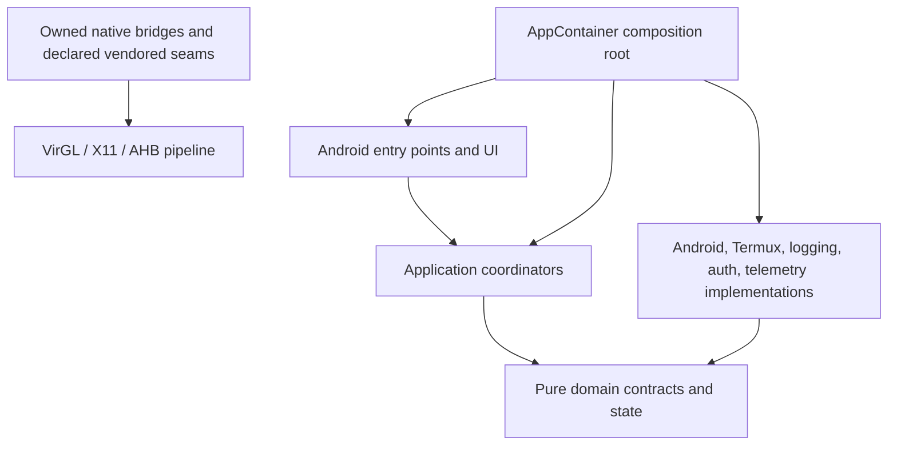

# Tablite Application Architecture

## Purpose

Tablite is an Android host and graphics-compatibility pipeline around an
official, byte-identical RuneLite distribution. Architecture rules protect
that boundary, keep frame telemetry honest, and make each pipeline stage
replaceable without turning activities, services, or scripts into service
locators.

## Dependency direction



- `domain` is pure Kotlin. It cannot import Android or implementation packages.
- Android entry points obtain already-wired dependencies from `AppContainer`.
- Constructor injection is the default. Concrete infrastructure is constructed
  only in `com.runelitetablet.di`.
- `SetupViewModelFactory` is a framework adapter in the composition package,
  not an alternate composition root.
- Raw operating-system process creation belongs in `platform/process`.
- `CaptureController` owns capture registry/exporter lifecycle. Producers may
  record through the active session, but may not start exporters independently.
- `FrameFlightRecorder` cannot log or perform file I/O on its hot path.

No reflection-based DI framework is required. The small, explicit Kotlin
composition root keeps dependency creation visible, testable, and independent
of a second code-generation/runtime system.

## RuneLite boundary

Production launch tooling may launch, observe, hash, and stop RuneLite. It may
not inject Java/native agents, preload code into RuneLite, mutate RuneLite
profiles or visual/plugin settings, synthesize gameplay input, inspect packets,
or collect screen/chat/key content. RuneLite client, gamepack, GPU plugin, and
plugin classes must match official artifacts.

Frame metric names identify their stage. In particular, Xlorie consumer redraws
and Android Choreographer callbacks are not produced or presented game frames.

## Source ownership

- First-party Kotlin: `app/src/main/java/com/runelitetablet`.
- First-party scripts: `app/src/main/assets/scripts`, `scripts`, and `tools`.
- First-party native unit:
  `app/src/main/cpp/rlawtsurface/rlawt_surface_consumer.c`.
- Deliberately patched vendored seam:
  `third_party/termux-x11-upstream/app/src/main/cpp/lorie/renderer.c`.
- Remaining `third_party` source is upstream-owned. It is not swept by
  first-party style rules. A modified vendored seam receives an explicit,
  compile-database-backed native check.

## Canonical fast verification

Run from the repository root:

```text
python tools/quality/analyzer.py
```

CI uses `--require-external-tools`. The analyzer owns stable `TBLxxx`
architectural diagnostics and delegates language semantics to Android Lint,
 Bash syntax, ShellCheck, PowerShell's parser, and NDK clang-tidy. There is no
lint baseline: an enforced violation is fixed or the check fails.

Every architecture rule and delegated diagnostic reports elapsed time and its
budget. Independent checks run concurrently. The whole command has a hard
60-second fast-verification gate and writes machine-readable timings to:

`runelite-tablet/app/build/reports/tablite-analyzer/timings.json`

Current budgets:

| Check | Budget |
|---|---:|
| Each `TBL` architecture rule | 1 s |
| All architecture rules | 5 s |
| Shell syntax / ShellCheck / PowerShell parser | 10 s each |
| Android Lint plus arm64 native configuration | 50 s |
| Owned-native clang-tidy | 8 s |
| Whole analyzer | less than 60 s |

Android Lint and the script checks overlap. Native clang-tidy runs after native
configuration so a clean checkout has a valid compile database. A timing
regression is a failing `TBL900` diagnostic, not an informational warning.

## Stable architecture diagnostics

| Code | Contract |
|---|---|
| `TBL001` | Domain purity |
| `TBL002` | UI cannot import infrastructure implementations |
| `TBL003` | Composition root owns concrete infrastructure |
| `TBL004` | Platform process adapter owns raw process creation |
| `TBL005` | No production RuneLite injection |
| `TBL006` | RuneLite settings remain user-owned |
| `TBL007` | Frame metrics have honest stage-specific names |
| `TBL008` | Capture tooling is observation-only |
| `TBL009` | Artifact integrity policy is present |
| `TBL010` | Frame recorder hot path has no logging/file I/O |
| `TBL011` | Capture controller owns exporter lifecycle |
| `TBL900` | Analyzer/check timing budget exceeded |

New strong rules are introduced in failing mode, all exposed violations are
repaired, and only then does optimization work resume. Permanent allowlists or
debt baselines are not part of this architecture.
